# Dockerfile - Ambiente de build para o AMD/Xilinx PetaLinux 2025.2


### LEIA ANTES DE USAR


 1) Base = Ubuntu 22.04, NAO Ubuntu 26.04.
    O instalador petalinux-v2025.2-11160223-installer.run e validado pela
    AMD apenas ate o Ubuntu 22.04 (ver UG1144 / release notes do 2025.2).
    O Ubuntu 26.04 "Resolute Raccoon" (04/2026) substitui coreutils e sudo
    por reescritas em Rust (uutils/sudo-rs) - mudanca de baixo nivel grande
    o bastante para arriscar quebrar, de forma sutil, os scripts do
    Yocto/bitbake por baixo do PetaLinux. Ninguem documentou essa
    combinacao funcionando ainda, entao esta imagem usa 22.04, que e a
    combinacao com suporte oficial e testada por terceiros para esta mesma
    versao do instalador. Se quiser arriscar o 26.04 mesmo assim, troque o
    FROM abaixo - o resto do Dockerfile nao muda.

 2) A ISO ubuntu-26.04-desktop-amd64.iso NAO entra neste fluxo em nenhum
    momento. Imagem Docker nao instala a partir de ISO de desktop: ela
    parte direto da rootfs minima "ubuntu:22.04" do Docker Hub. Uma ISO
    de desktop so faria sentido para instalar Ubuntu numa VM/maquina
    fisica - nao existe ../../images/passo equivalente em Dockerfile.

 3) Antes do build, baixe manualmente (exige login na AMD/Xilinx) o arquivo
       petalinux-v2025.2-11160223-installer.run
    e coloque-o na MESMA pasta deste Dockerfile.

### COMO USAR
```bash 
   docker build -t petalinux:2025.2 .
   docker run -it --privileged --rm -v "$(pwd)/projects:/home/petalinux/projects" petalinux:2025.2
```
 Dentro do container, petalinux-create / petalinux-config / petalinux-build
 ja funcionam direto: o entrypoint carrega o settings.sh automaticamente.

 ESPACO EM DISCO: reserve pelo menos 100-150 GB livres para a imagem +
 projetos de build (exigencia do proprio PetaLinux, nao e so o instalador).


# Tutorial: Criando um Projeto PetaLinux a partir do Vivado/Vitis

Este tutorial mostra o fluxo completo para gerar uma imagem Linux embarcado (PetaLinux) a partir de um projeto de hardware criado no Vivado: exportação do XSA, geração do Software Device Tree, criação do projeto PetaLinux, configuração, build e geração da imagem de boot.

## Pré-requisitos

- **Vivado / Vitis** 2025.2 instalados e licenciados
- **PetaLinux Tools** 2025.2 instalado (`/petalinux` neste tutorial)
- BSP da placa alvo (neste exemplo, **ZCU106**)
- Ambiente Linux com espaço em disco suficiente (o build do Yocto pode passar de 50 GB) e, de preferência, várias CPUs disponíveis para paralelizar o build
- Requisito Total de ESPAÇO EM DISCO +200GB

## Sumário

1. [Preparando o Hardware no Vivado](#1-preparando-o-hardware-no-vivado)
2. [Exportando o Hardware (XSA)](#2-exportando-o-hardware-xsa)
3. [Gerar o Software Device Tree (SDT)](#3-gerar-o-software-device-tree-sdt)
4. [Criar e configurar o projeto PetaLinux](#4-criar-e-configurar-o-projeto-petalinux)
5. [Incorporar as características do hardware ao PetaLinux](#5-incorporar-as-características-do-hardware-ao-petalinux)
6. [Configurar o rootfs](#6-configure-o-petalinux-root-filesystem-rootfs)
7. [Compilar o PetaLinux](#7-compile-o-petalinux)

---

## 1. Preparando o Hardware no Vivado

### 1.1 Carregar o ambiente Vitis

Antes de exportar o hardware, confira no gerenciador de fontes do Vivado se o *block design* e os demais arquivos do projeto estão corretos e sem erros pendentes.

<p align="center">
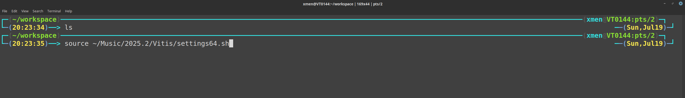
</p>

```bash
source <diretório de instalação do Vitis>/settings.sh
```

Exemplo:

```bash
source ~/Music/2025.2/Vitis/settings.sh
```

### 1.2 Validar o Block Design

Abra o *Block Design* e valide a arquitetura do sistema (processador, barramentos, IPs periféricos, clocks e resets). É neste momento que se confirma se todos os blocos necessários para o PetaLinux (UART, memória DDR, controlador de armazenamento, etc.) estão presentes e conectados corretamente.
"
<p align="center">
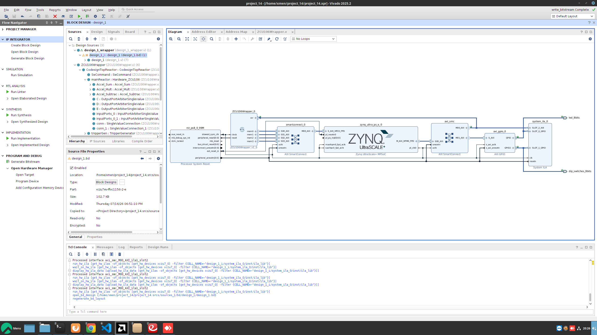
</p>

## 2. Exportando o Hardware (XSA)

Com o hardware validado, o próximo ../../images/passo é gerar o arquivo **XSA** (Xilinx Support Archive), que descreve o hardware e será consumido pelo PetaLinux para criar o BSP (Board Support Package).

No Vivado, vá em **File → Export → Export Hardware** e siga o assistente:

**../../images/passo 1 – Início do assistente de exportação.** Confirme que deseja exportar o hardware do projeto atual.

<p align="center">
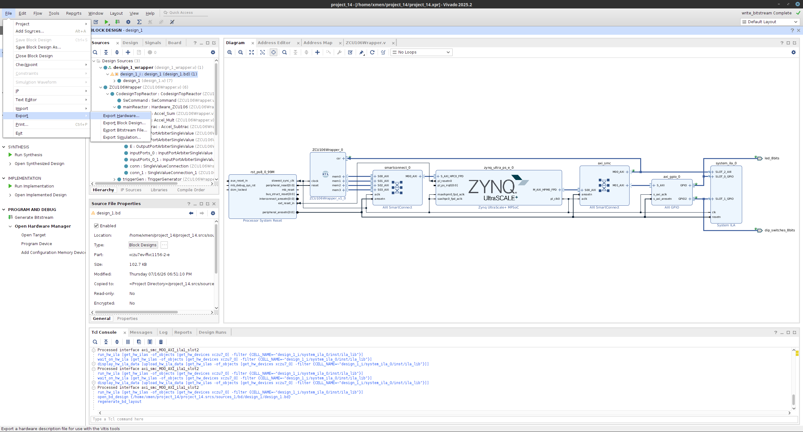
</p>

<p align="center">
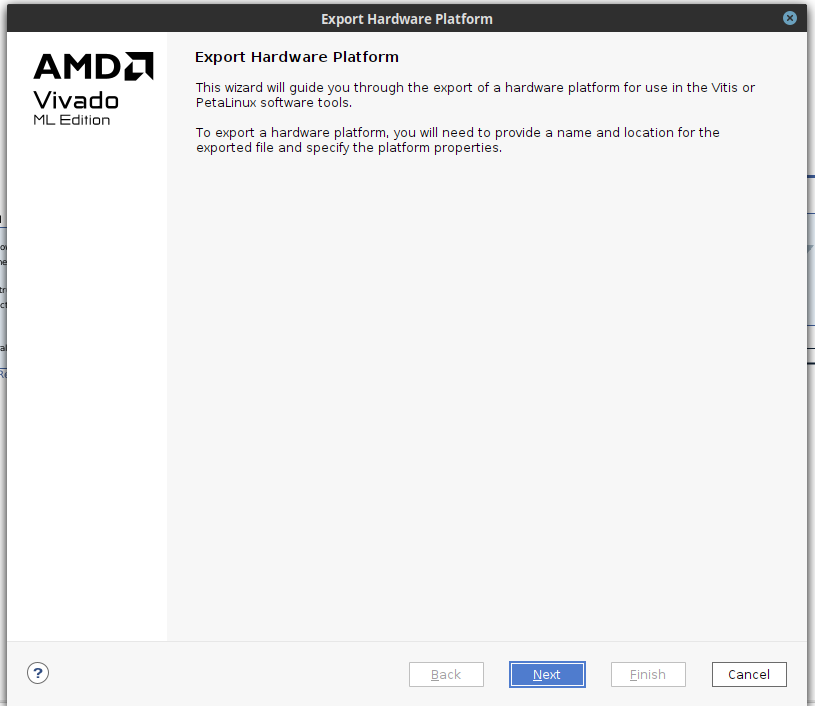
</p>

**../../images/passo 2 – Incluir o bitstream.** Marque a opção **Include Bitstream**, para que o arquivo XSA contenha a configuração completa do FPGA.

<p align="center">
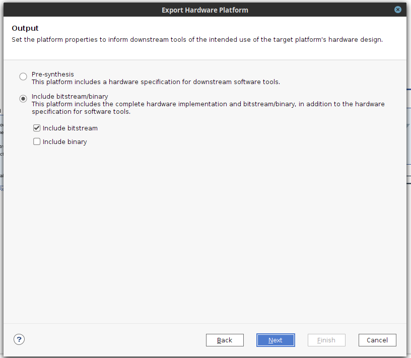
</p>

**../../images/passo 3 – Escolher o diretório de destino.** Neste exemplo:

```bash
/home/xmen/workspace/<nome_do_projeto>
```

<p align="center">
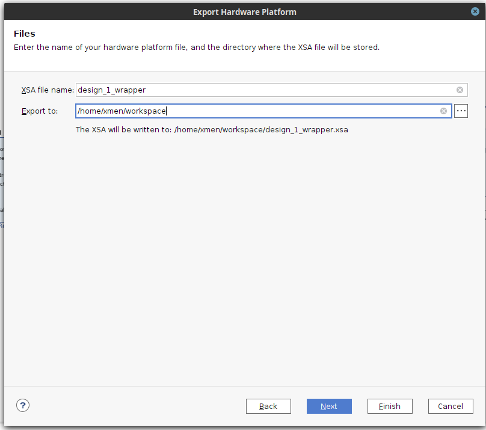
</p>

**../../images/passo 4 – Confirmar a exportação.** Verifique se o arquivo `.xsa` foi gerado no diretório correto:

```bash
cd /home/xmen/workspace
ls
# <nome do projeto>.xsa
```

<p align="center">
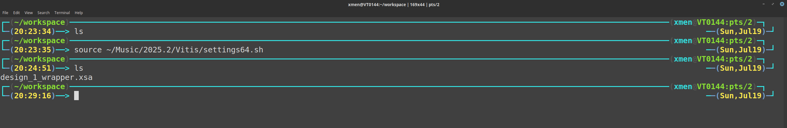
</p>

## 3. Gerar o Software Device Tree (SDT)

Crie um script Tcl chamado `sdt.tcl`:

<p align="center">
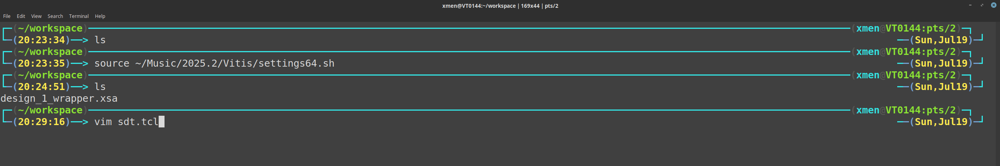
</p>

Conteúdo do `sdt.tcl`:

```tcl
set outdir [lindex $argv 1]
set xsa [lindex $argv 0]
exec rm -rf $outdir
sdtgen set_dt_param -xsa $xsa -dir $outdir -board_dts zcu106-reva
sdtgen generate_sdt
```

> **Nota:** ajuste `zcu106-reva` para o identificador correspondente à sua placa, caso não esteja usando uma ZCU106.

<p align="center">
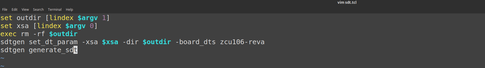
</p>

Confirme que o arquivo foi criado com sucesso:

```bash
cd /home/xmen/workspace/
cat sdt.tcl
```

<p align="center">
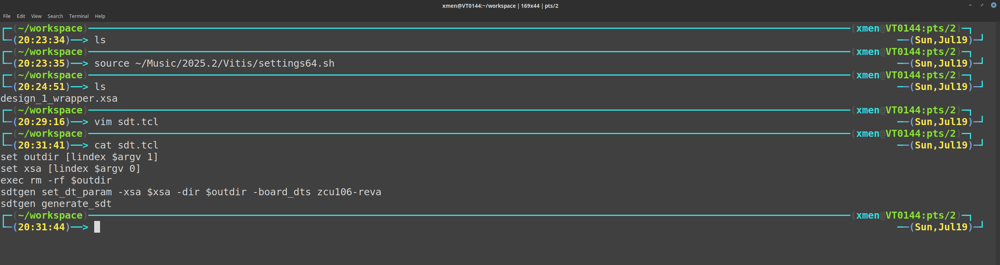
</p>

Execute o script com `xsct`, a partir do diretório de workspace:

```bash
cd /home/xmen/workspace/
```

Sintaxe geral:

```bash
xsct sdt.tcl <caminho_do_arquivo_XSA> sdt_outdir
```

Exemplo usado neste tutorial:

```bash
xsct sdt.tcl design_1_wrapper.xsa sdt_outdir
```

<p align="center">
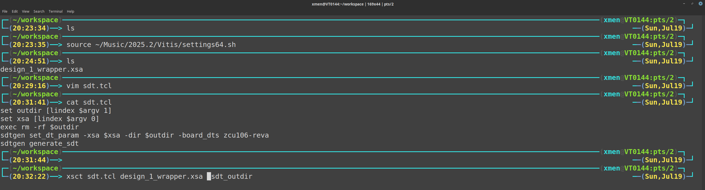
</p>

<p align="center">
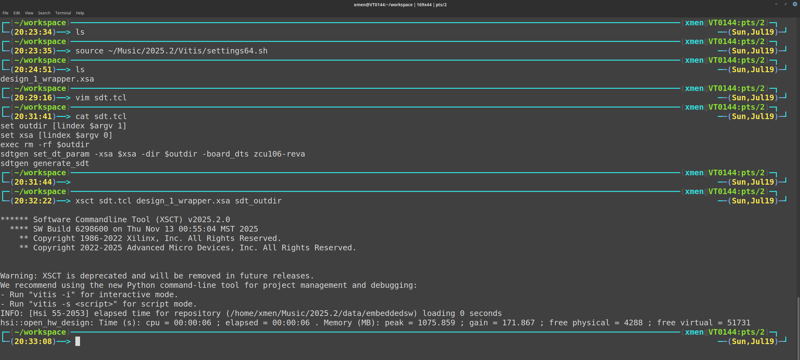
</p>

Ao final, o diretório `sdt_outdir` deve conter os arquivos de device tree gerados a partir do hardware exportado.

## 4. Criar e configurar o projeto PetaLinux

Vá até o diretório de instalação do PetaLinux e carregue o ambiente:

```bash
cd /petalinux
source settings.sh
```

<p align="center">
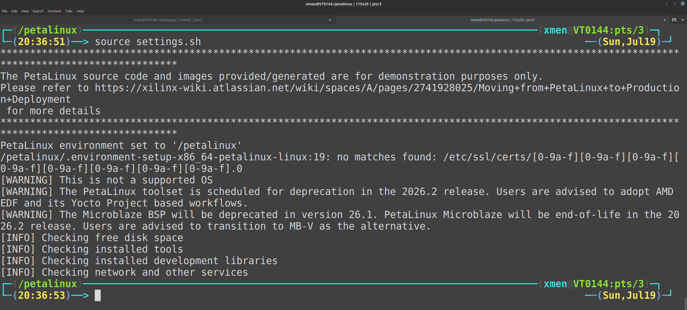
</p>

Após o carregamento, volte ao diretório do projeto:

```bash
cd -
```

Crie o projeto PetaLinux a partir do BSP da placa:

```bash
petalinux-create -t project -s <caminho_do_arquivo>.bsp
```

Exemplo usado neste tutorial:

```bash
petalinux-create -t project -s /petalinux/xilinx-zcu106-v2025.2-11160223.bsp
```

Após a execução, o diretório base do projeto deve conter a estrutura padrão de um projeto PetaLinux:

<p align="center">
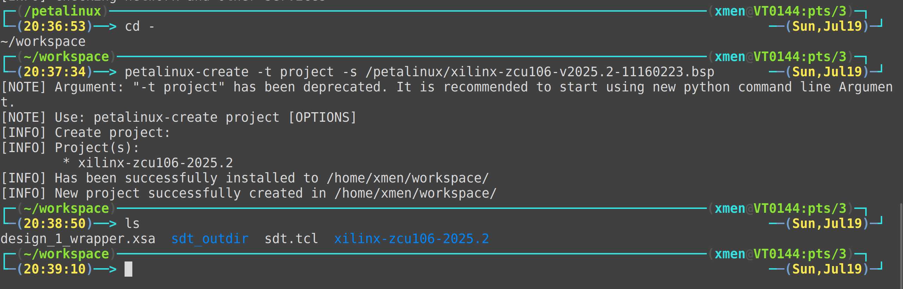
</p>

## 5. Incorporar as características do hardware ao PetaLinux

Entre no diretório do projeto criado (o nome varia conforme a versão do PetaLinux):

```bash
cd xilinx-zcu106-20xx.x
```

Neste tutorial:

```bash
cd xilinx-zcu106-2025.2
```

Aponte o projeto para o hardware exportado (diretório do SDT gerado na etapa 3):

```bash
petalinux-config --get-hw-description ../sdt_outdir
```

<p align="center">
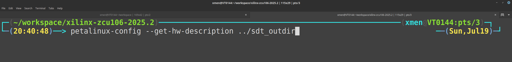
</p>

### 5.1 Threads paralelas de build

No menu de configuração, acesse:

**PetaLinux System Configuration → Yocto Settings → Parallel Thread Execution**

<p align="center">
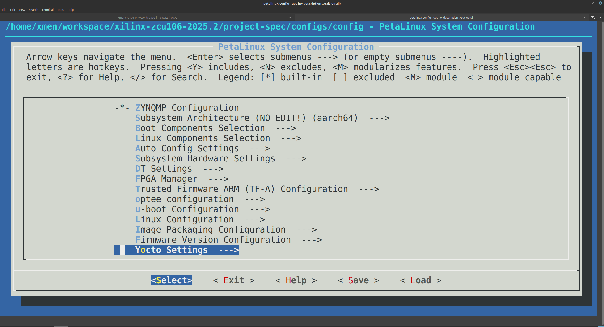
</p>

Verifique a quantidade de CPUs disponíveis no seu ambiente de trabalho:

```bash
neofetch
```

<p align="center">
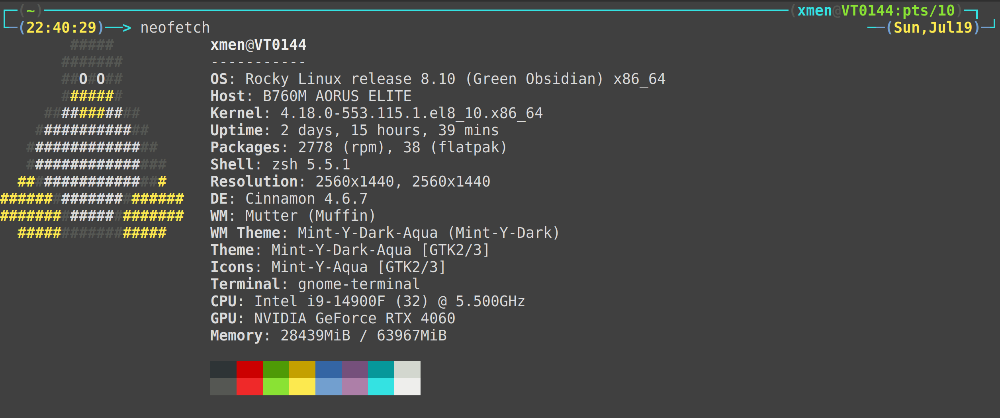
</p>

Neste exemplo, um Intel i9-14900F com 32 núcleos:

<p align="center">
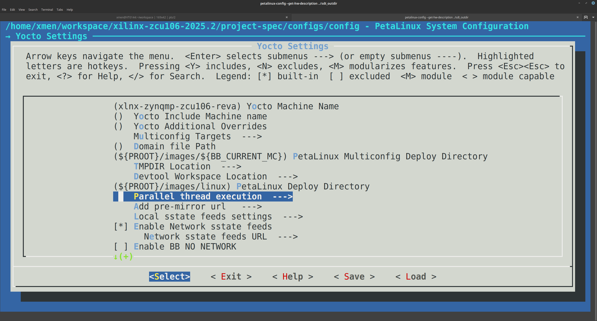
</p>

Defina os campos de paralelismo (**BB Number of Threads**, **PARALLEL_MAKE**, etc.) de acordo com a quantidade de núcleos disponível, para acelerar o build:

<p align="center">
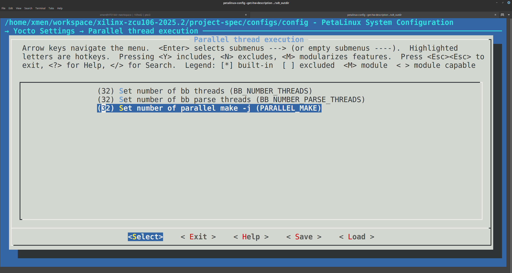
</p>

### 5.2 Argumentos de boot do kernel (UIO genérico)

Acesse:

**PetaLinux System Configuration → DT Settings → Kernel Bootargs → Add extra boot args**

Adicione um driver de kernel **Generic UIO (Userspace I/O)** à imagem, para permitir acesso aos periféricos da PL a partir do userspace:

<p align="center">
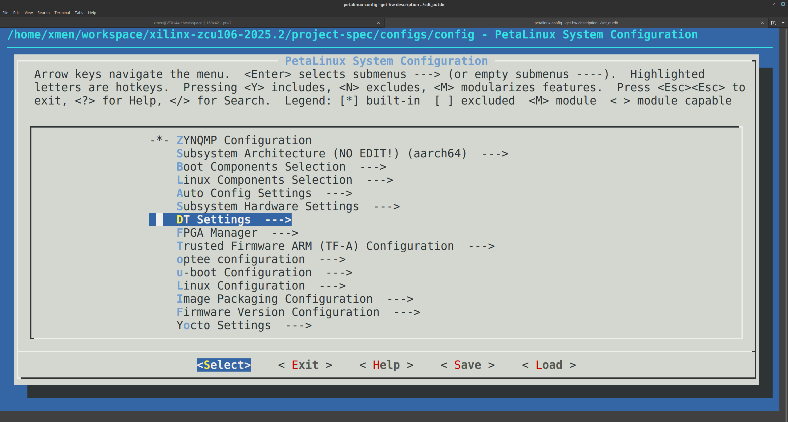
</p>

<p align="center">
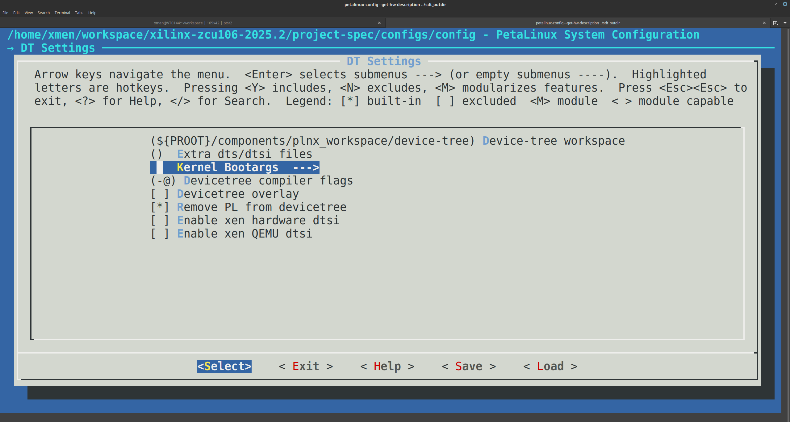
</p>

<p align="center">
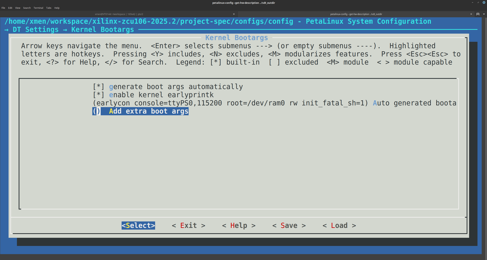
</p>

Adicione o argumento:

```
uio_pdrv_genirq.of_id=generic-uio
```

<p align="center">
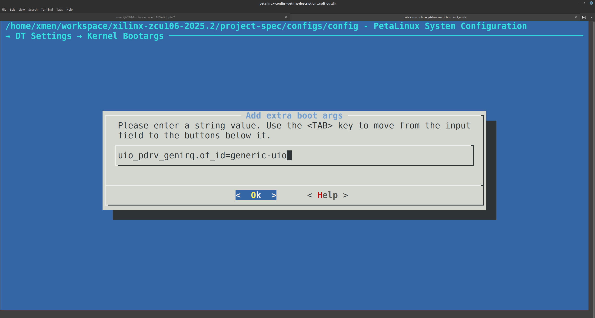
</p>

### 5.3 Manter a PL no device tree

Acesse **PetaLinux System Configuration → DT Settings** e **desmarque** a opção **Remove PL from devicetree**, para que os IPs da lógica programável apareçam no device tree final:

<p align="center">
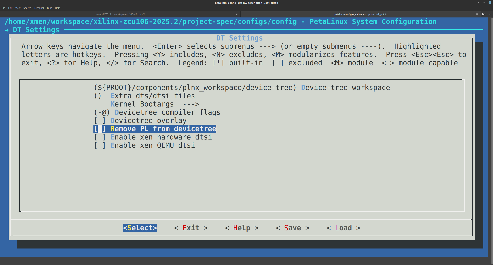
</p>

<p align="center">
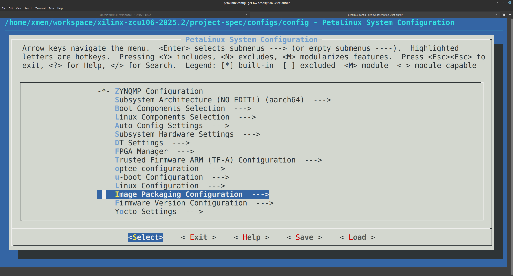
</p>

### 5.4 Empacotamento de imagem

Acesse **PetaLinux System Configuration → Image Packaging Configuration** e **desmarque** a opção **Copy final images to tftpboot** (a menos que você use boot via TFTP):

<p align="center">
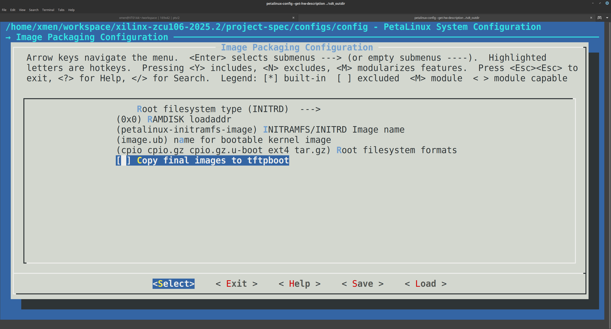
</p>

Salve as configurações e saia do menu **PetaLinux System Configuration**:

<p align="center">
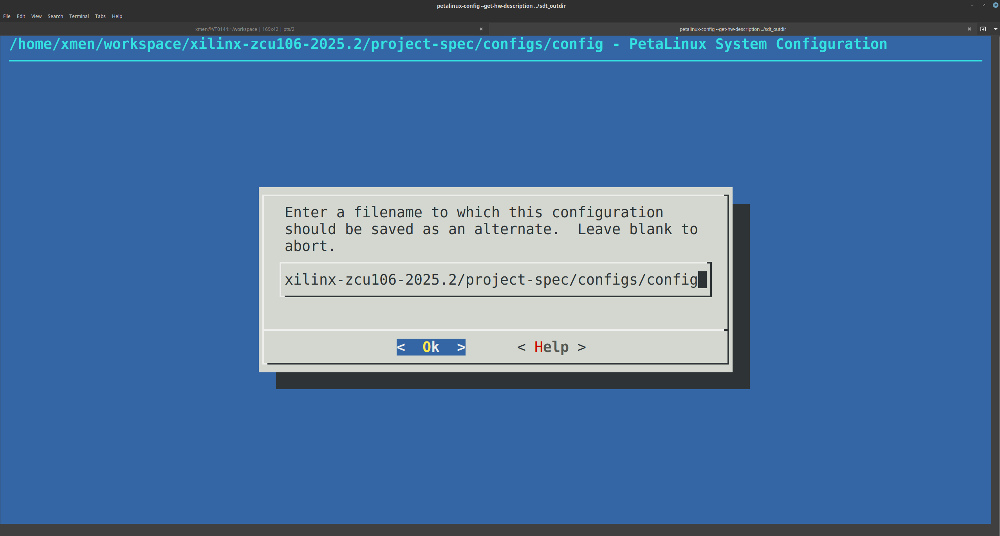
</p>

<p align="center">
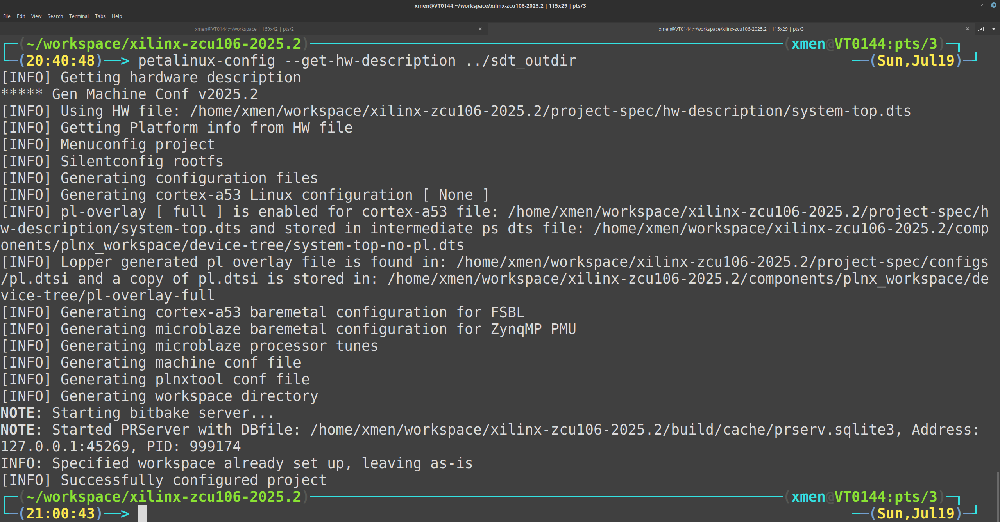
</p>

### 5.5 Sincronizar o device tree da PL

A partir do diretório do projeto (`/home/xmen/workspace/xilinx-zcu106-2025.2/`), abra os dois arquivos abaixo e copie o conteúdo de `pl.dtsi` para dentro de `system-user.dtsi`:

```bash
code ../sdt_outdir/pl.dtsi
code project-spec/meta-user/recipes-bsp/device-tree/files/system-user.dtsi
```

<p align="center">
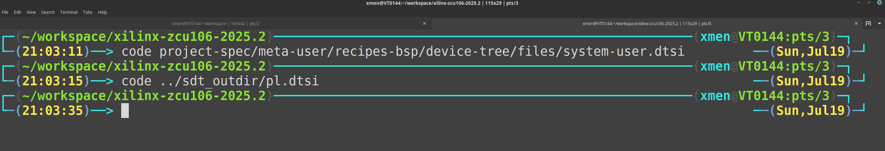
</p>

Na linha correspondente ao nó `uio`, altere a propriedade `compatible` para:

```
compatible = "generic-uio";
```

Salve e feche o VS Code:

<p align="center">
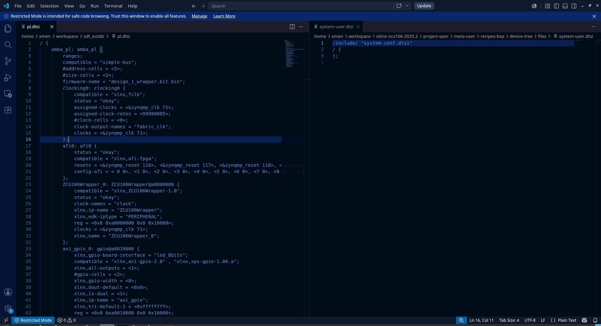
</p>

<p align="center">
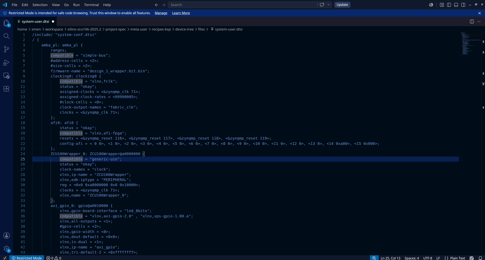
</p>

<p align="center">
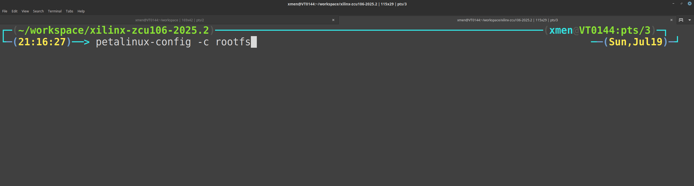
</p>

## 6. Configure o PetaLinux root filesystem (rootfs)

```bash
petalinux-config -c rootfs
```

> **Dica:** use `/` para pesquisar as opções a serem habilitadas e selecione o item com a barra de espaço (tecla numérica) do teclado.

### Habilite os seguintes itens no rootfs

| Item | Categoria | Prioridade |
|---|---|---|
| `libstdc++` | libs | Obrigatório |
| `kmod` | misc | Obrigatório |
| `udev` | base | Obrigatório |
| `libgpiod` | libs | Necessário (GPIO) |
| `gpio-demo` | console → utils | Recomendado |
| `ssh-server-dropbear` **ou** `ssh-server-openssh` (não os dois) | console → network | Recomendado |
| `python3-numpy` | devel | Opcional (análise de dados) |
| `packagegroup-core-buildessential` | petalinux | Opcional (dev na placa, aumenta o tamanho da imagem) |
| `util-linux` | base | Necessário (boot via pen drive) |
| `e2fsprogs` | console → utils | Necessário (boot via pen drive) |
| `dosfstools` | console → utils | Necessário (boot via pen drive) |
| `gdb` | console → utils | Necessário (debug — marcar explicitamente) |
| `packagegroup-core-tools-debug` | petalinux | Opcional (símbolos de debug) |
| `strace` | console → utils | Opcional (debug) |
| `sudo` | base | Obrigatório |

**Observação:** em `gpio-demo`, mantenha as seguintes opções habilitadas:

<p align="center">
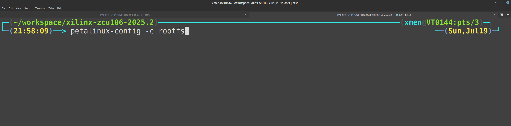
</p>

<p align="center">
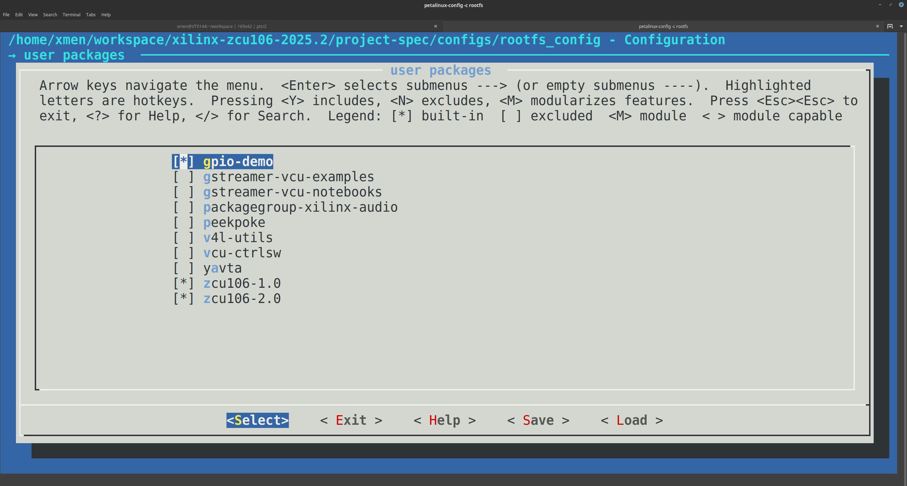
</p>

Salve as configurações e saia do menu **Configuration**:

<p align="center">
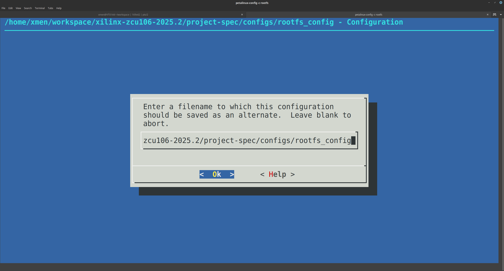
</p>

## 7. Compile o PetaLinux

O build pode levar de alguns minutos a algumas horas, dependendo do hardware do seu computador e da quantidade de threads configurada.

```bash
petalinux-build
```

<p align="center">
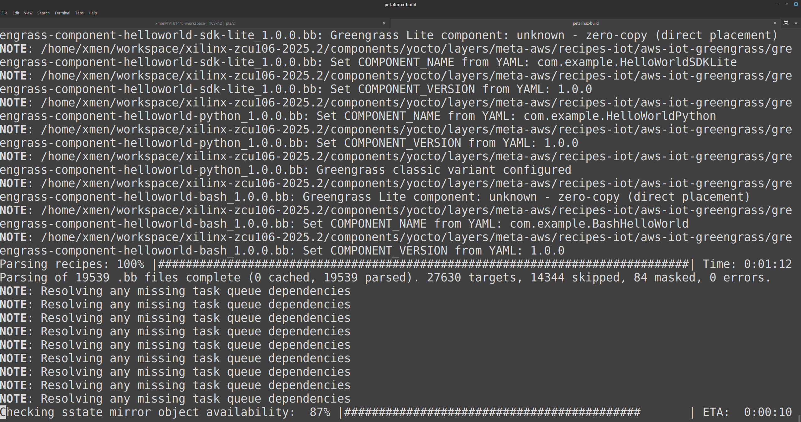
</p>

É comum que a **primeira execução** apresente avisos e erros relacionados a cache do Yocto/BitBake, fazendo o build falhar. Nesse caso, basta executar o comando novamente — o cache já parcialmente construído normalmente resolve o problema na segunda tentativa. Para mais detalhes sobre falhas conhecidas de build, consulte o guia de troubleshooting do PetaLinux/Yocto, por exemplo a seção ["Build failures" da documentação do RPi Camera FMC](https://rpi.camerafmc.com/en/latest/troubleshooting.html) ou a documentação oficial da AMD/Xilinx para a sua versão de ferramentas.

<p align="center">
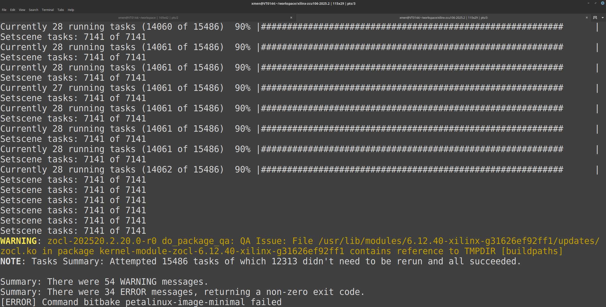
</p>

Execute novamente:

```bash
petalinux-build
```

<p align="center">
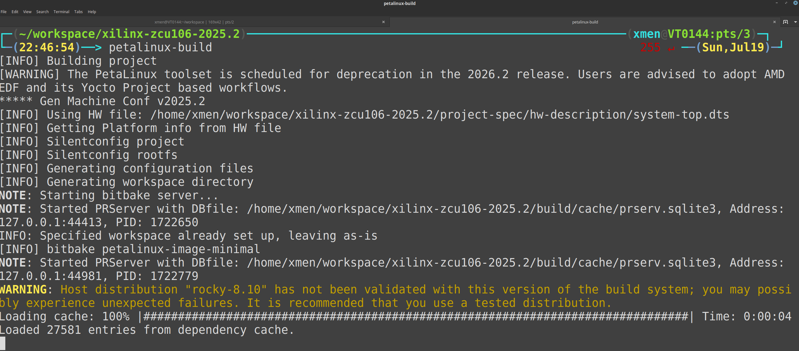
</p>

### Compilação bem-sucedida

Ao final, os artefatos de boot (`BOOT.BIN`, `boot.scr`, `image.ub`/`Image`, `system.dtb`, rootfs) estarão disponíveis em `images/linux/` dentro do projeto, prontos para serem gravados em um cartão SD/pen drive ou usados via TFTP/JTAG.

<p align="center">
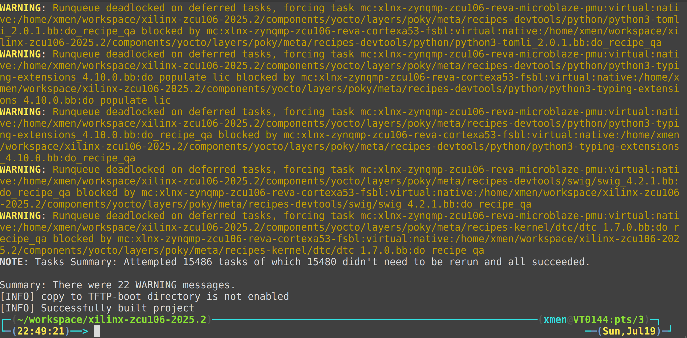
</p>
