# Cyber-Physical Systems — Ambiente PetaLinux (Docker + Tutorial)

> 🇧🇷 **Português** · [🇬🇧 English](../02-petalinux-vivado.md) — a versão em inglês é a canônica.

<!-- translated-from: docs/02-petalinux-vivado.md@f800594874f32cb2b225e0293e286872822d3d3e -->

Este documento reúne duas partes:

1. **Dockerfile** — ambiente de build containerizado para o AMD/Xilinx PetaLinux 2025.2.
2. **Tutorial** — passo a passo completo para gerar uma imagem PetaLinux a partir de um projeto de hardware feito no Vivado, incluindo o boot na placa e o deploy de uma aplicação Cyber-Physical Systems (reator Lingua Franca) na FPGA.

---

## Parte 1 — Dockerfile: ambiente de build para o PetaLinux 2025.2

### Leia antes de usar

1. **Base = Ubuntu 22.04, não Ubuntu 26.04.**
   O instalador `petalinux-v2025.2-11160223-installer.run` é validado pela AMD apenas até o Ubuntu 22.04 (ver UG1144 / release notes do 2025.2). O Ubuntu 26.04 "Resolute Raccoon" (04/2026) substitui `coreutils` e `sudo` por reescritas em Rust (`uutils`/`sudo-rs`) — uma mudança de baixo nível grande o bastante para arriscar quebrar, de forma sutil, os scripts do Yocto/BitBake por baixo do PetaLinux. Ninguém documentou essa combinação funcionando ainda, então esta imagem usa 22.04, que é a combinação com suporte oficial e testada por terceiros para esta mesma versão do instalador. Se quiser arriscar o 26.04 mesmo assim, troque o `FROM` no Dockerfile — o resto do arquivo não muda.

2. **A ISO `ubuntu-26.04-desktop-amd64.iso` não entra neste fluxo em nenhum momento.**
   Imagem Docker não instala a partir de ISO de desktop: ela parte direto da rootfs mínima `ubuntu:22.04` do Docker Hub. Uma ISO de desktop só faria sentido para instalar Ubuntu numa VM/máquina física — não existe um passo equivalente no Dockerfile.

3. **Baixe o instalador manualmente antes do build.**
   Faça login no site da AMD/Xilinx, baixe o arquivo `petalinux-v2025.2-11160223-installer.run` e coloque-o na mesma pasta deste Dockerfile.

### Como usar

```bash
docker build -t petalinux:2025.2 .
docker run -it --privileged --rm -v "$(pwd)/projects:/home/petalinux/projects" petalinux:2025.2
```

Dentro do container, `petalinux-create`, `petalinux-config` e `petalinux-build` já funcionam direto: o entrypoint carrega o `settings.sh` automaticamente.

> **Espaço em disco:** reserve pelo menos 100–150 GB livres para a imagem + projetos de build (exigência do próprio PetaLinux, não apenas do instalador).

---

## Parte 2 — Tutorial: criando um projeto PetaLinux a partir do Vivado/Vitis

Este tutorial mostra o fluxo completo para gerar uma imagem Linux embarcado (PetaLinux) a partir de um projeto de hardware criado no Vivado: exportação do XSA, geração do Software Device Tree, criação do projeto PetaLinux, configuração, build, geração da imagem de boot e deploy final na FPGA.

### Pré-requisitos

- **Vivado / Vitis** 2025.2 instalados e licenciados.
- **PetaLinux Tools** 2025.2 instalado (`/petalinux` neste tutorial).
- BSP da placa alvo (neste exemplo, **ZCU106**).
- Ambiente Linux com espaço em disco suficiente — o build do Yocto pode passar de 50 GB — e, de preferência, várias CPUs disponíveis para paralelizar o build.
- **Requisito total de espaço em disco: +200 GB.**

### Sumário

1. [Preparando o Hardware no Vivado](#1-preparando-o-hardware-no-vivado)
2. [Exportando o Hardware (XSA)](#2-exportando-o-hardware-xsa)
3. [Gerar o Software Device Tree (SDT)](#3-gerar-o-software-device-tree-sdt)
4. [Criar e configurar o projeto PetaLinux](#4-criar-e-configurar-o-projeto-petalinux)
5. [Incorporar as características do hardware ao PetaLinux](#5-incorporar-as-características-do-hardware-ao-petalinux)
6. [Configurar o RootFS](#6-configurar-o-rootfs)
7. [Compilar o PetaLinux](#7-compilar-o-petalinux)
8. [Boot via JTAG / Pen Drive](#8-boot-via-jtag--pen-drive)
9. [Deploy na FPGA](#9-deploy-na-fpga)
10. [Links Úteis](#10-links-úteis)

---

## 1. Preparando o hardware no Vivado

Esta seção cobre o que acontece entre o `.tar.gz` gerado pelo container e a
exportação do XSA: criar o projeto, trazer o `ZCU106Wrapper.v` para o Block
Design, atribuir o endereço do acelerador e gerar o bitstream.

> **Entrada:** `ZCU106Wrapper.v` e `Q_srl.v`, extraídos de `deploy_all_files/`
> no `.tar.gz` produzido por `make deploy ... ARCH=arm`.
> **Saídas:** o bitstream (gravado na PL) e o `.xsa` (consumido pelo PetaLinux).

### 1.1 Carregar o ambiente Vitis

```bash
source <diretório de instalação do Vitis>/settings.sh
```

Exemplo:

```bash
source ~/Music/2025.2/Vitis/settings.sh
```

<p align="center">
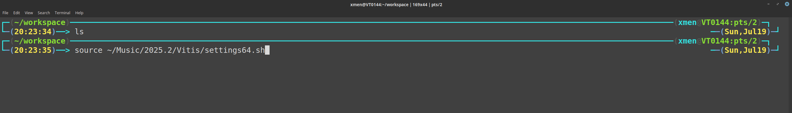
</p>

### 1.2 Criar o projeto

**File → Project → New**, e avance no assistente.

<p align="center">
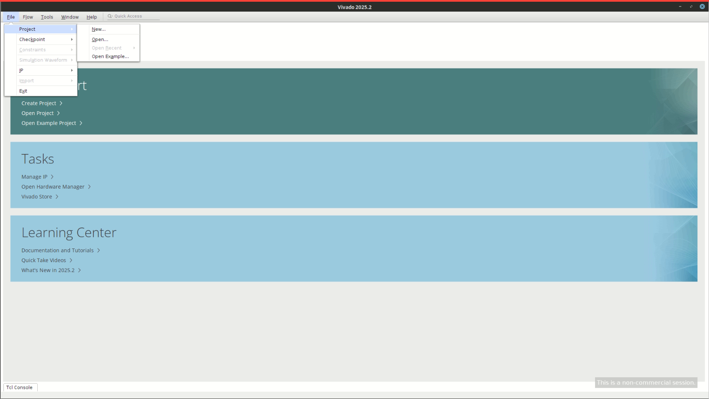
</p>

<p align="center">
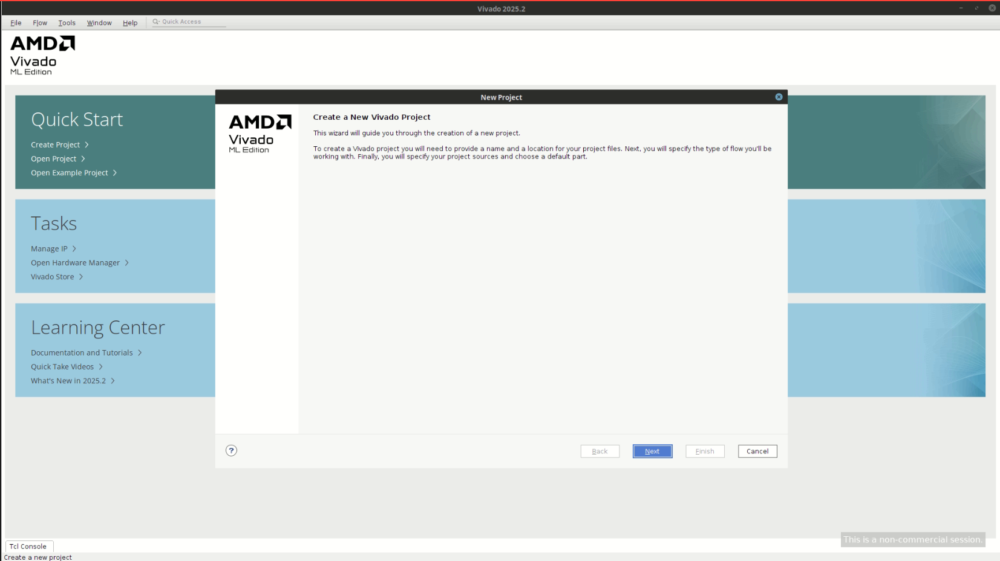
</p>

Dê nome e escolha o diretório do projeto (neste tutorial, `project_14` em
`/home/xmen`):

<p align="center">
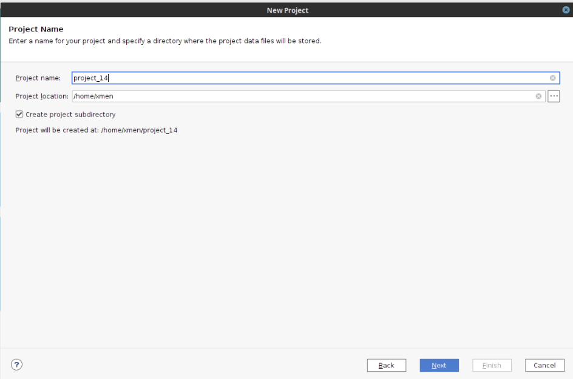
</p>

Selecione **RTL Project** e deixe *Do not specify sources at this time*
desmarcado — os arquivos `.v` serão adicionados no próximo passo:

<p align="center">
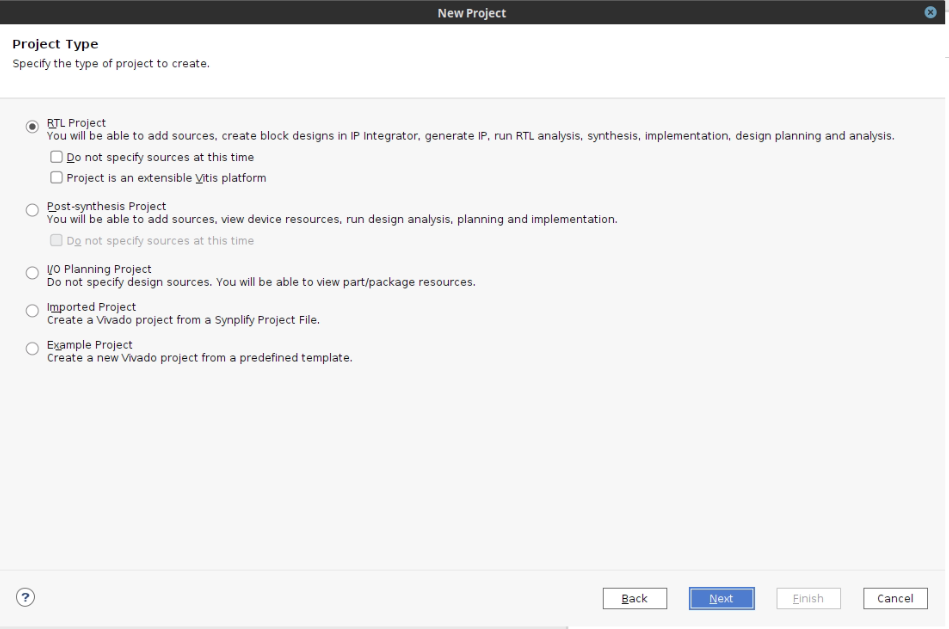
</p>

### 1.3 Trazer o RTL gerado pelo compilador

Copie o `<projeto>_<timestamp>_deploy.tar.gz` do container para o host onde o
Vivado está instalado e extraia:

<p align="center">
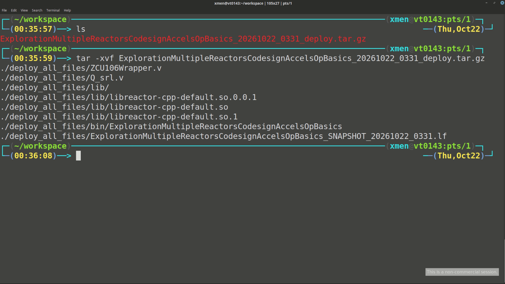
</p>

Na etapa **Add Sources** do assistente, escolha *Add or create design sources*:

<p align="center">
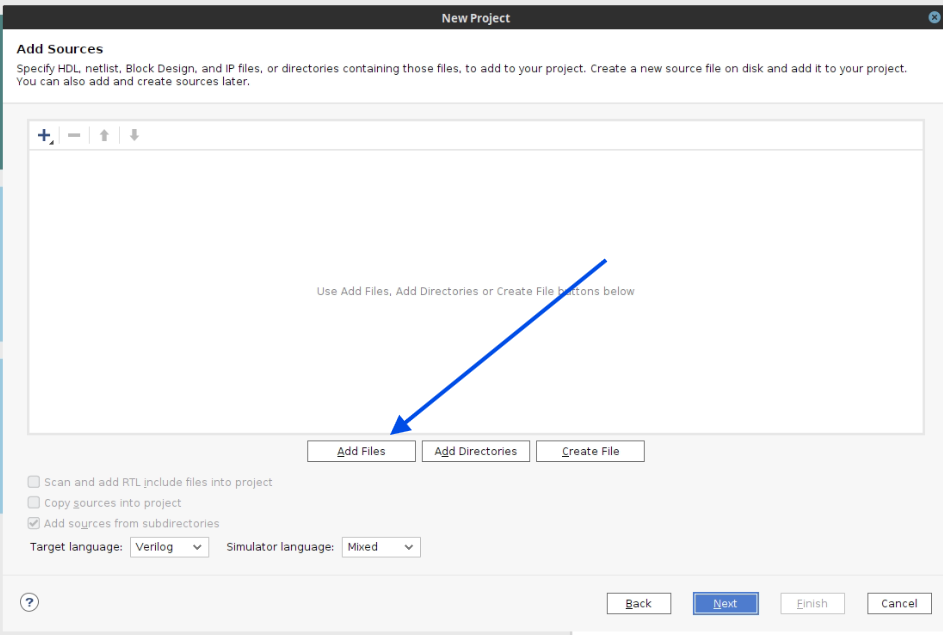
</p>

Navegue até a pasta extraída e selecione **os dois** arquivos: `ZCU106Wrapper.v`
e `Q_srl.v`.

> **O `Q_srl.v` não é opcional.** Ele é o único arquivo Verilog do
> `fpga-tidbits` que não é gerado pelo Chisel, e é instanciado por
> `SRLQueue`/`FPGAQueue` dentro do wrapper. Sem ele, o `ZCU106Wrapper` fica
> incompleto e **aparece acinzentado** (incompatível) na hora de adicioná-lo ao
> Block Design — ver 1.6.

<p align="center">
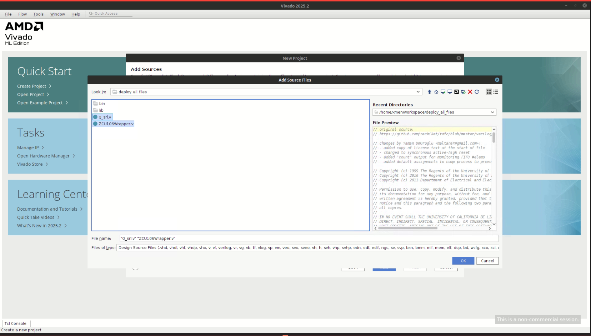
</p>

Na seleção de part, vá à aba **Boards** e procure por `zcu106`:

<p align="center">
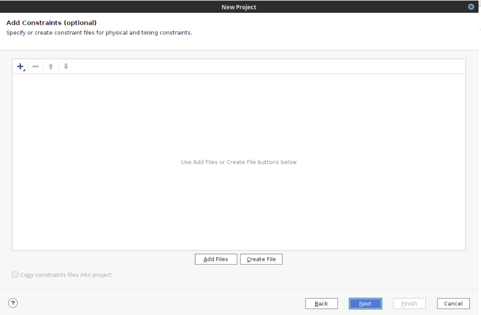
</p>

<p align="center">
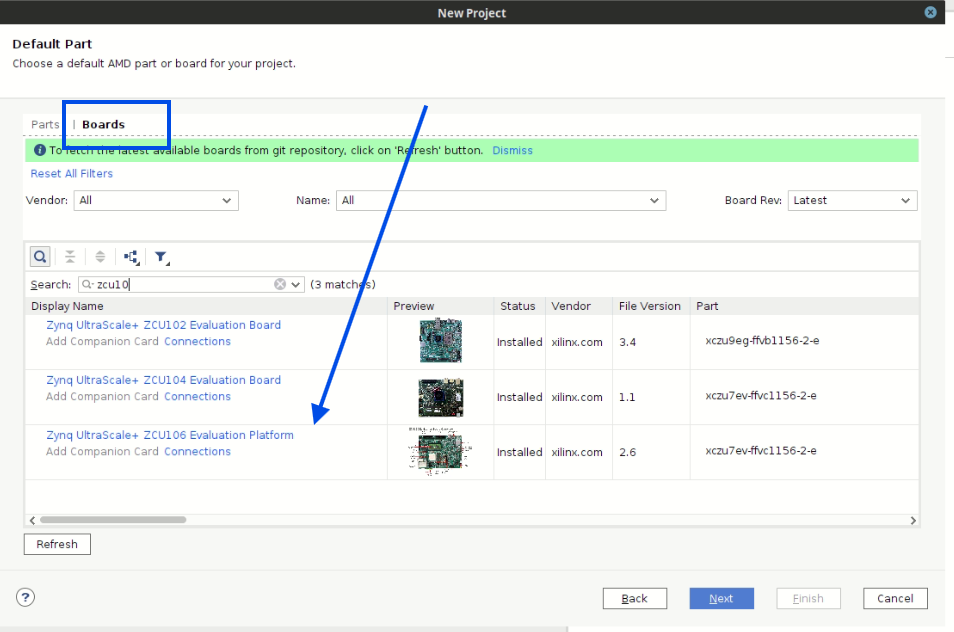
</p>

Isso define a part `xczu7ev-ffvc1156-2-e` — o mesmo part number registrado no
`fpgaPartMap` do compilador para a `ZCU106`. Confirme o resumo e finalize:

<p align="center">
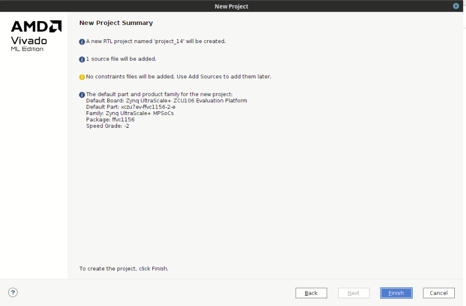
</p>

Com o projeto criado, a aba Sources mostra a hierarquia completa do acelerador —
`CodesignTopReactor`, `Hardware_ZCU106` e os reactors que você escreveu no `.lf`
(`Accel_Sum`, `Accel_Mult`, `Accel_Subtrac`), além do `RegFile` e dos adaptadores
AXI:

<p align="center">
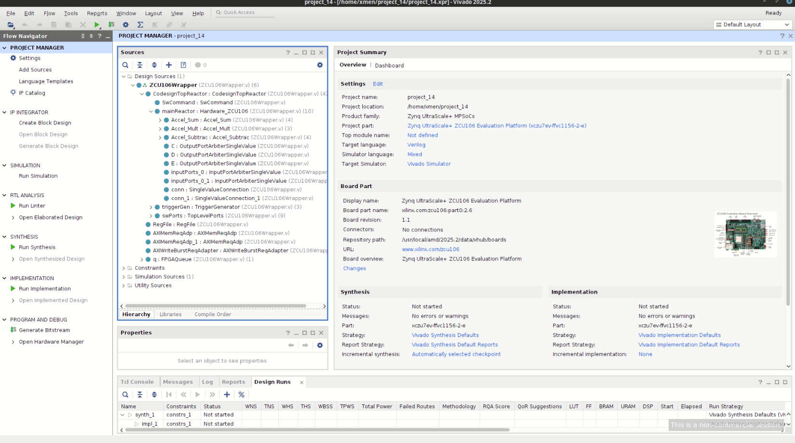
</p>

É um bom momento para conferir que os reactors do seu `.lf` realmente viraram
hardware — cada um aparece como um módulo próprio.

### 1.4 Criar o Block Design

**IP INTEGRATOR → Create Block Design**:

<p align="center">
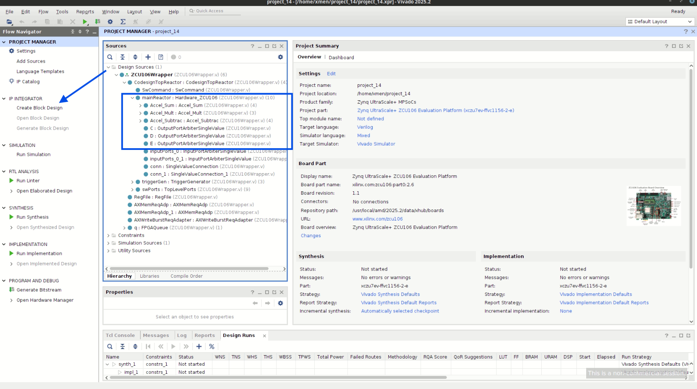
</p>

Aceite o nome padrão (`design_1`):

<p align="center">
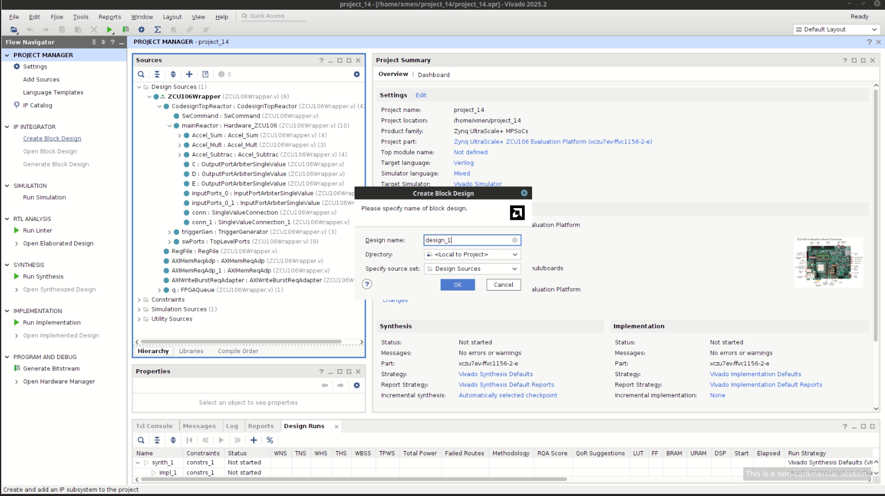
</p>

### 1.5 Adicionar o processador

No diagrama vazio, clique em **+** (Add IP), digite `zynq` e escolha
**Zynq UltraScale+ MPSoC**:

<p align="center">
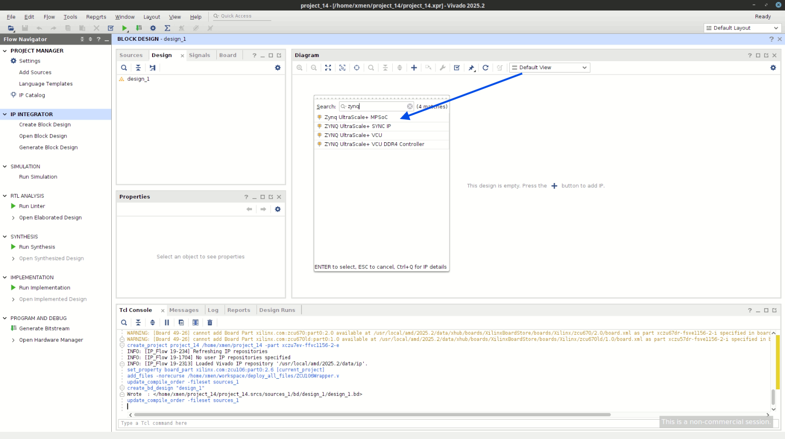
</p>

Rode o **Run Block Automation** oferecido na barra verde: ele aplica as
predefinições da ZCU106 (DDR, UART, Ethernet, clocks).

### 1.6 Adicionar o `ZCU106Wrapper`

O wrapper é RTL do projeto, não um IP do catálogo. Clique com o botão direito em
uma área vazia do diagrama e escolha **Add Module…**:

<p align="center">
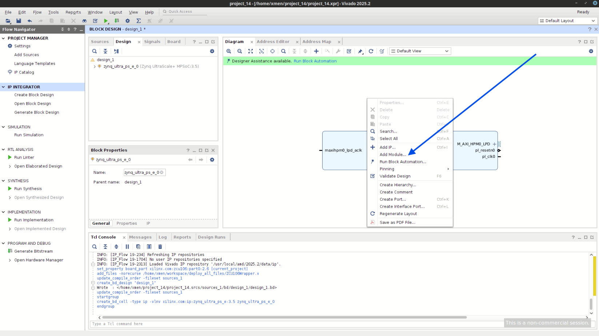
</p>

Selecione `ZCU106Wrapper` na lista:

<p align="center">
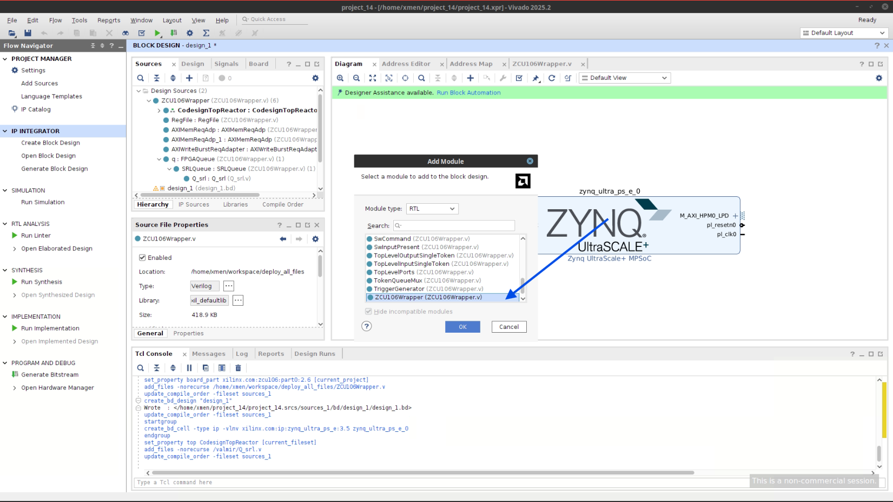
</p>

> **Se o `ZCU106Wrapper` aparecer acinzentado:** falta o `Q_srl.v` no projeto
> (1.3). Os submódulos aparecem normalmente e só o topo fica desabilitado,
> porque o Vivado o trata como hierarquia incompleta. Adicione o arquivo por
> **Add Sources** e reabra o diálogo. Desmarcar *Hide incompatible modules* só
> revela o problema — não o resolve.

O bloco entra no diagrama já com as interfaces AXI agrupadas: `csr` (AXI4-Lite,
slave) e `mem0..mem3` (AXI4, master), mais `clock` e `reset`.

### 1.7 Periféricos opcionais

LEDs e dip switches não são exigidos pelo fluxo — use se quiser um sinal visual
de que o sistema está vivo. **Add IP → `AXI GPIO`**:

<p align="center">
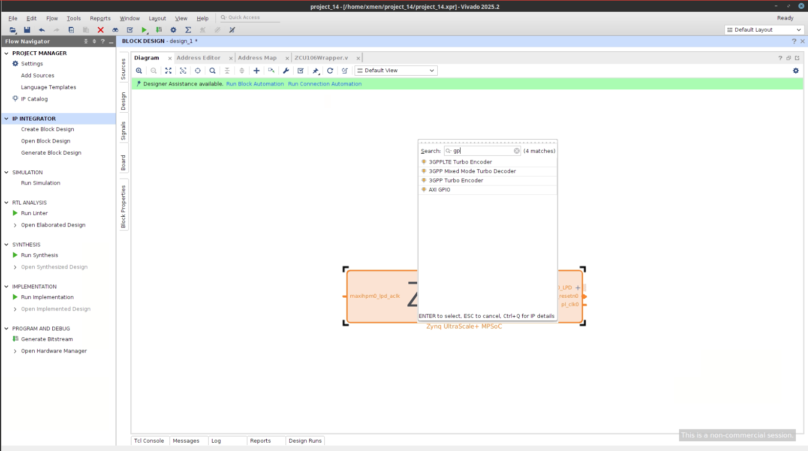
</p>

Neste ponto o diagrama tem os três blocos, ainda sem conexões:

<p align="center">
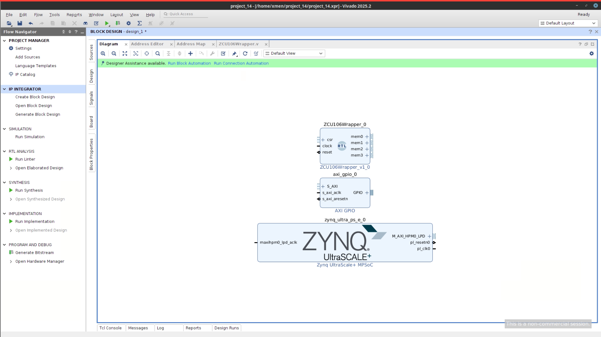
</p>

### 1.8 Conexões automáticas

Clique em **Run Connection Automation** na barra verde e marque tudo. A primeira
passada conecta o `csr` do wrapper e as interfaces do GPIO ao
`M_AXI_HPM0_FPD` do PS, criando o `AXI SmartConnect` e o `Processor System Reset`:

<p align="center">
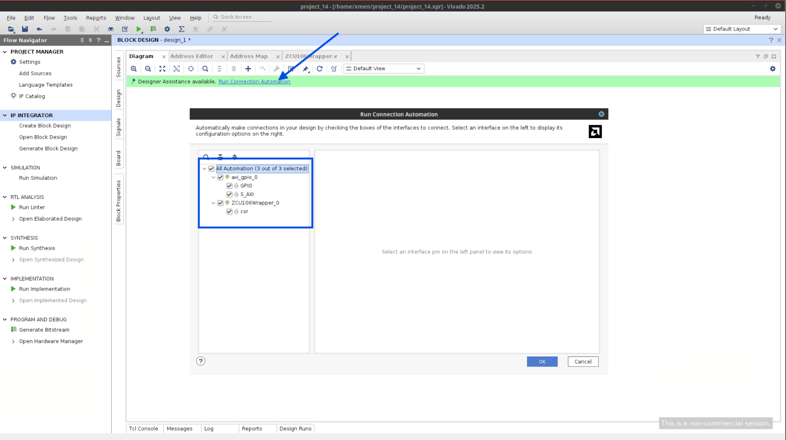
</p>

Rode novamente para as portas de memória: `mem0..mem3` do wrapper em direção ao
PS:

<p align="center">
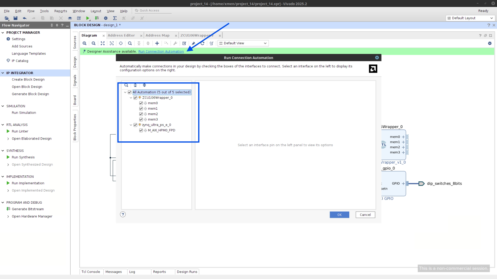
</p>

> **Nota:** o acelerador usa efetivamente `mem0`; `mem1..mem3` são portas
> plugadas com defaults pelo `AXIPlatformWrapper`. Conectá-las não faz mal, e
> deixá-las desconectadas também funciona — reduz a fiação do diagrama.

### 1.9 Clock e reset

O `pl_clk0` do PS alimenta o wrapper, o `Processor System Reset` e os
SmartConnects. Neste tutorial ele está em **100 MHz**.

> **Esse número precisa ir para o `.lf`.** O RTL gerado incrementa os
> registradores de tempo lógico (`physicalTag`, `regClock`) a cada pulso de
> clock, somando o valor de `clock-period`. Com 100 MHz:
>
> ```lf
> target Codesign {
>   fpgaBoard: ZCU106,
>   clock-period: 10 nsec   // 10 ns = 100 MHz, igual ao pl_clk0
> }
> ```
>
> O default é 1 nsec (1 GHz). Gerar o RTL com o default e sintetizar a 100 MHz
> deixa toda a coordenação de tags 10× dessincronizada do tempo real.

>**Verifique o reset.** A entrada `reset` do `ZCU106Wrapper` é
> **ativa-em-alto**: ligue em `peripheral_reset` do `Processor System Reset`,
> **não** em `peripheral_aresetn`. Invertido, o acelerador fica permanentemente
> em reset — a síntese passa sem reclamar e a falha só aparece na leitura de
> assinatura, em tempo de execução.

### 1.10 Depuração com System ILA (opcional)

Para observar as transações AXI no Hardware Manager, clique com o botão direito
sobre a conexão do `csr` e escolha **Debug**:

<p align="center">
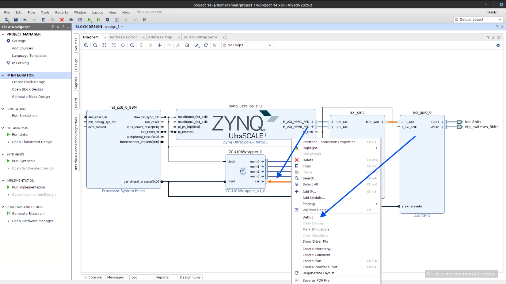
</p>

O Connection Automation passa então a oferecer a inserção do **System ILA**. Os defaults
(*Data and Trigger* em todos os canais, clock do `pl_clk0`) servem:

<p align="center">
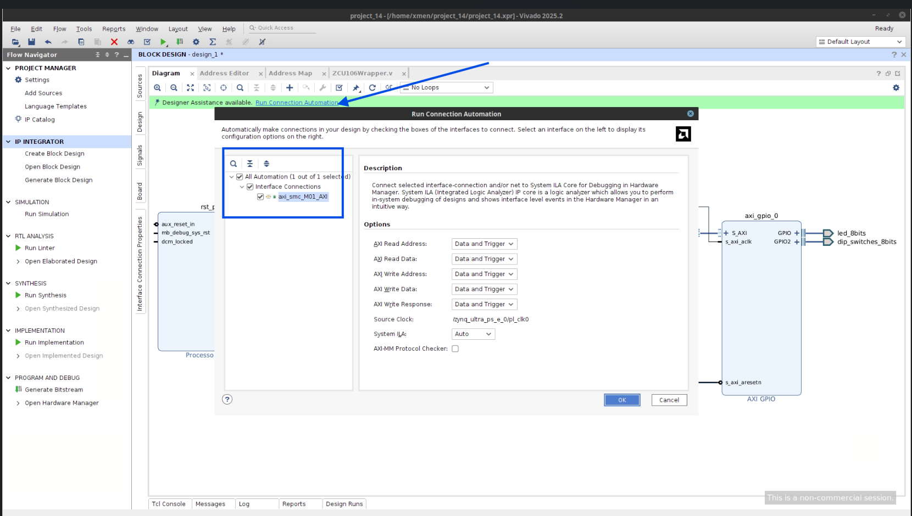
</p>

### 1.11 Endereço do acelerador

Abra a aba **Address Editor**. Se estiver vazia, clique em *Generate Address Map*:

<p align="center">
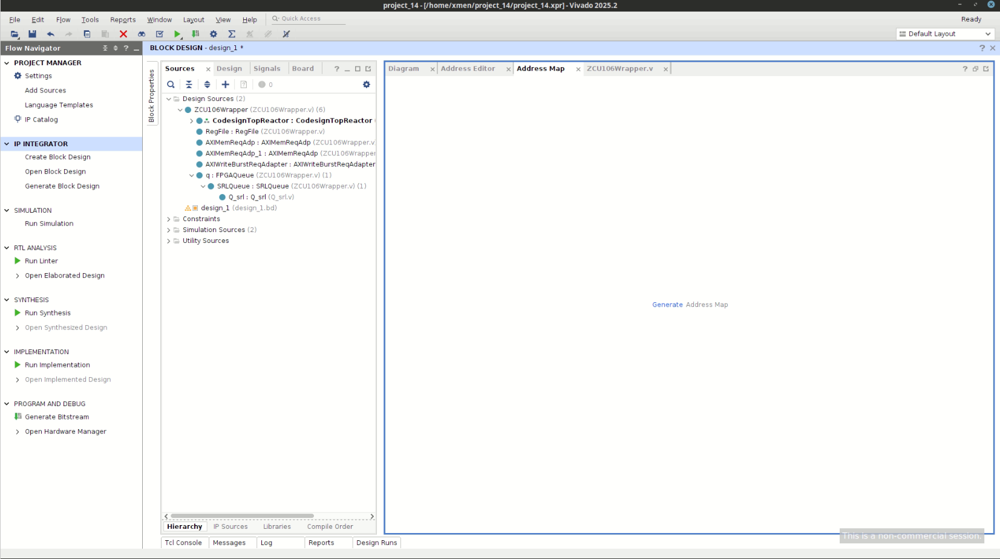
</p>

Por padrão o Vivado atribui ao `csr` um endereço alto com range de 4G — no
exemplo, `0x5_0000_0000`:

<p align="center">
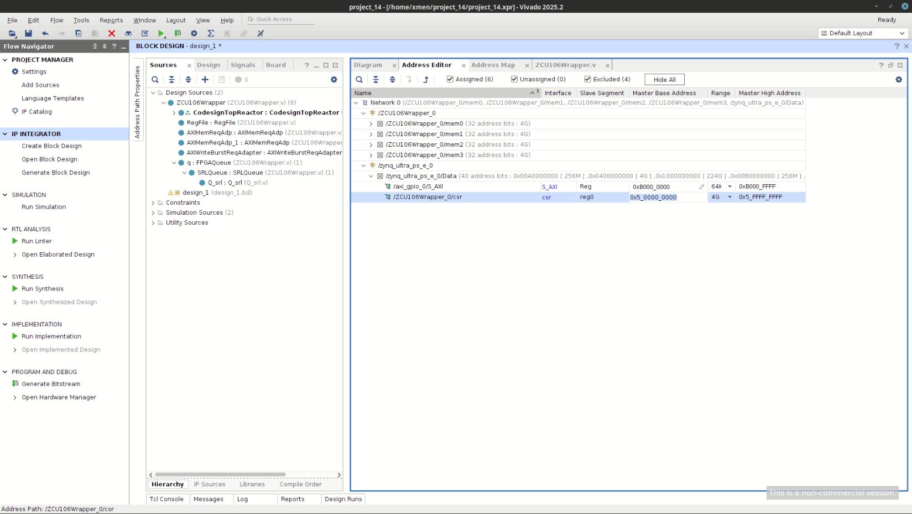
</p>

**Altere para `0xA000_0000` com range `64K`**, a faixa convencional de
periféricos da PL no MPSoC:

<p align="center">
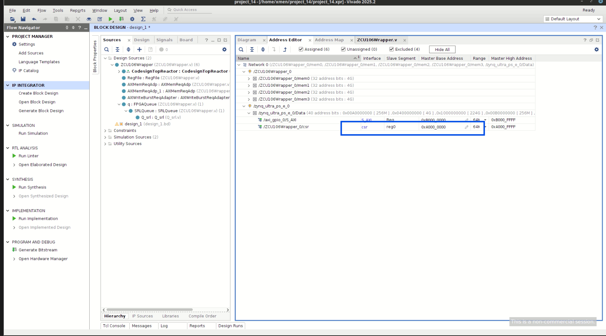
</p>

> **Por que esse endereço importa.** Ele está definido diretamente no código (hardcoded).
>
> 1. O `sdtgen` o escreve no device tree como o nó `ZCU106Wrapper@a0000000`.
> 2. O kernel expõe esse nome em `/sys/class/uio/uioN/name`.
> 3. O `platform-mpsoc-uio.cpp` procura pela substring `"ZCU106Wrapper"` nesse
>    arquivo para descobrir qual `/dev/uioN` abrir.
>
> Como a busca é por substring, mudar o endereço não quebra o driver — mas
> renomear o wrapper, sim. E o range de 4G do default faz o acelerador ocupar
> uma faixa absurda do mapa de endereços; 64K é o tamanho real do regfile.

### 1.12 Gerar o wrapper HDL

Valide o diagrama com **Validate Design** (`F6`). Depois, na aba Sources, clique
com o botão direito em `design_1` e escolha **Create HDL Wrapper** (deixe o
Vivado gerenciar):

<p align="center">
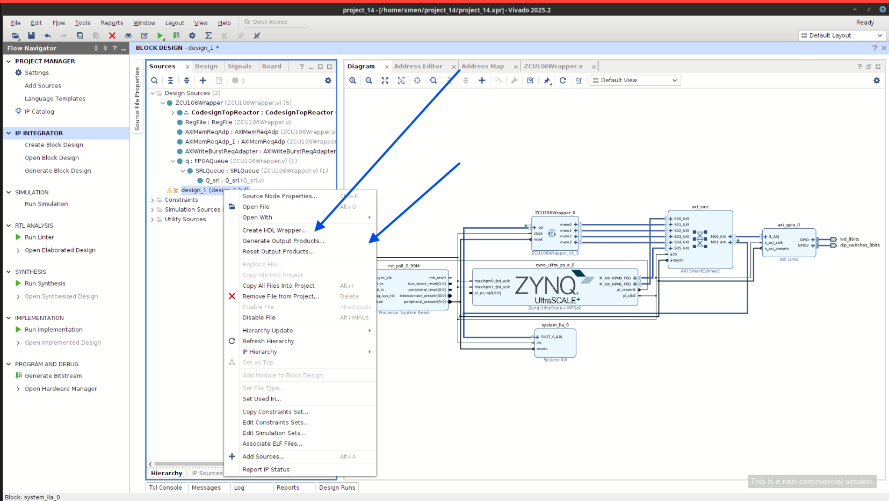
</p>

Defina o `design_1_wrapper` como topo do projeto (**Set as Top**):

<p align="center">
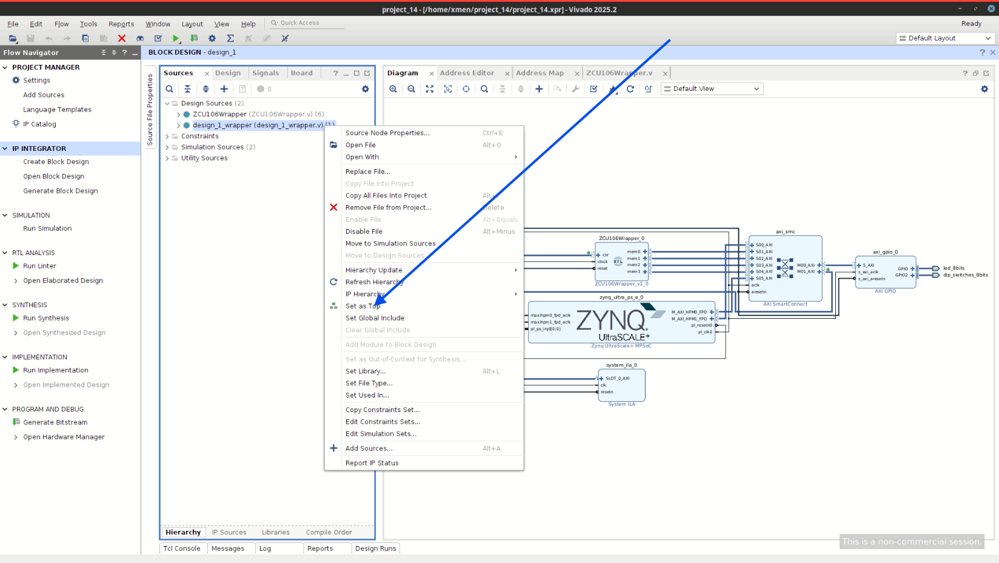
</p>

O `design_1_wrapper` passa a aparecer em negrito na hierarquia:

<p align="center">
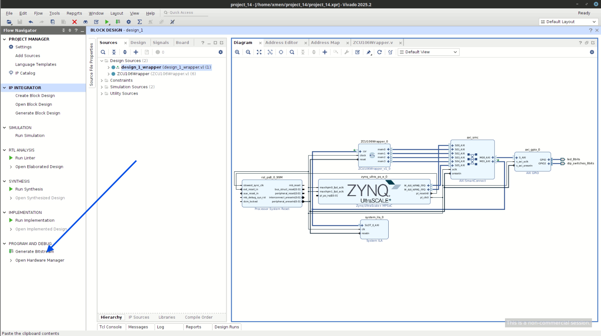
</p>

### 1.13 Gerar o bitstream

**PROGRAM AND DEBUG → Generate Bitstream**. Ajuste *Number of jobs* para o
número de núcleos disponíveis:

<p align="center">
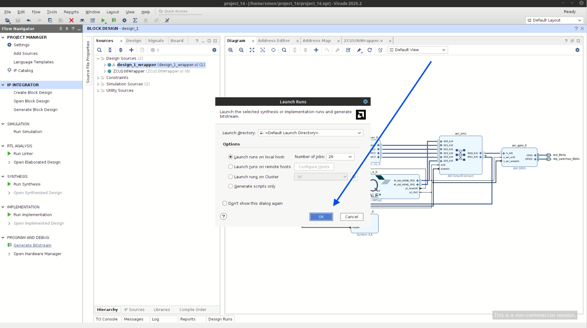
</p>

Síntese e implementação levam dezenas de minutos. Com `write_bitstream Complete`
na barra de status, siga para a exportação do XSA.


## 2. Exportando o Hardware (XSA)

Com o hardware validado, o próximo passo é gerar o arquivo **XSA** (Xilinx Support Archive), que descreve o hardware e será consumido pelo PetaLinux para criar o BSP (Board Support Package).

No Vivado, vá em **File → Export → Export Hardware** e siga o assistente:

**Passo 1 – Início do assistente de exportação.** Confirme que deseja exportar o hardware do projeto atual.

<p align="center">
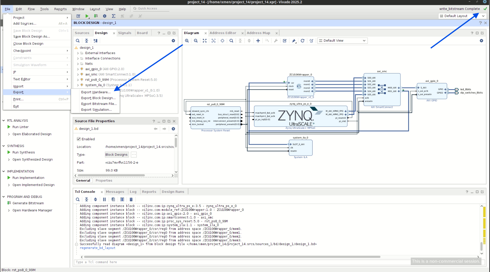
</p>

<p align="center">
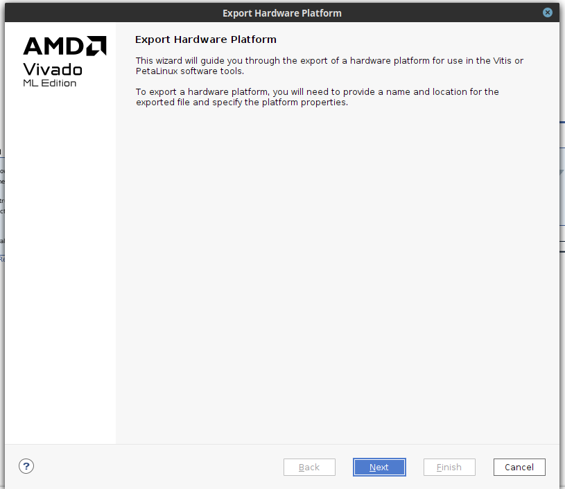
</p>

**Passo 2 – Incluir o bitstream.** Marque a opção **Include Bitstream**, para que o arquivo XSA contenha a configuração completa do FPGA.

<p align="center">
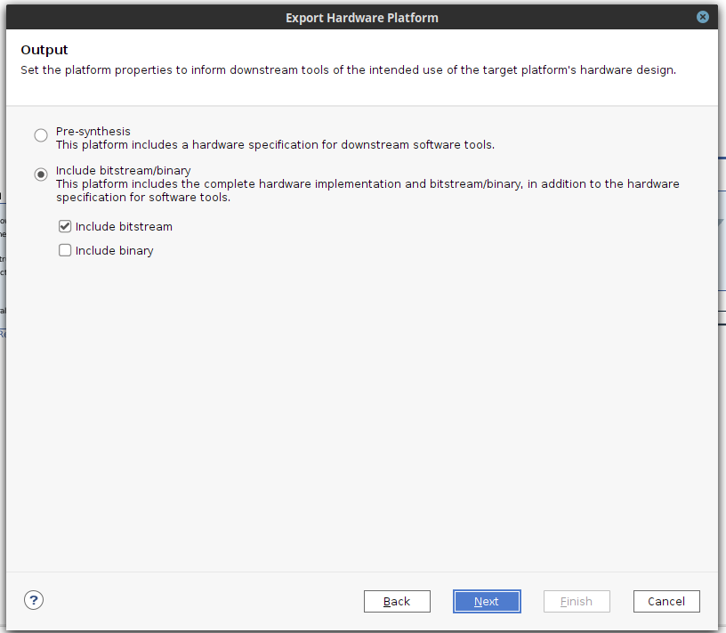
</p>

**Passo 3 – Escolher o diretório de destino.** Neste exemplo:

```bash
/home/xmen/workspace/<nome_do_projeto>
```

<p align="center">
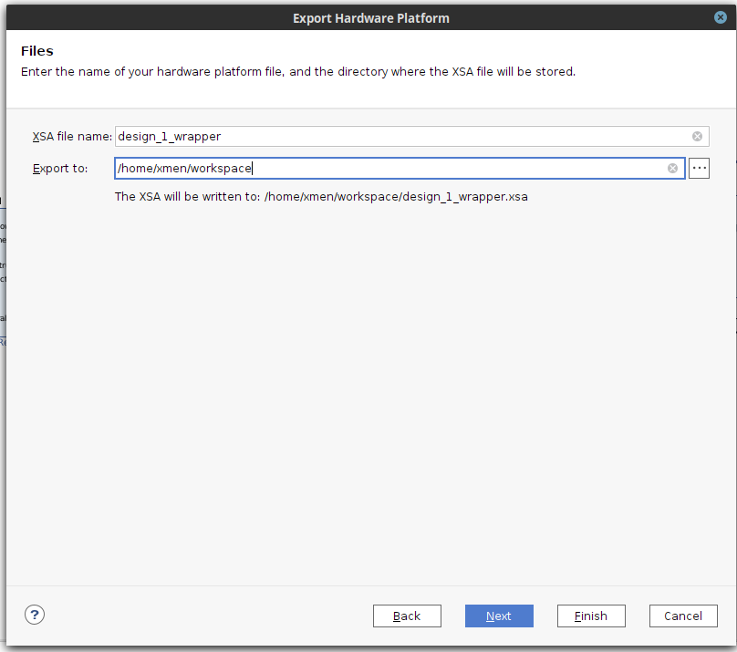
</p>

**Passo 4 – Confirmar a exportação.** Verifique se o arquivo `.xsa` foi gerado no diretório correto:

```bash
cd /home/xmen/workspace
ls
# <nome do projeto>.xsa
```

<p align="center">
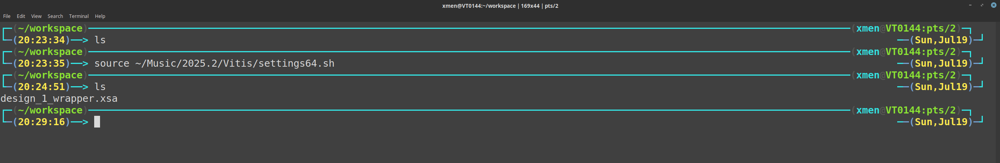
</p>

## 3. Gerar o Software Device Tree (SDT)

Crie um script Tcl chamado `sdt.tcl`:

<p align="center">
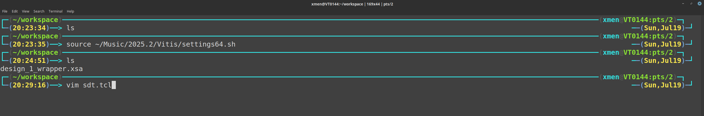
</p>

Conteúdo do `sdt.tcl`:

```tcl
set outdir [lindex $argv 1]
set xsa [lindex $argv 0]
exec rm -rf $outdir
sdtgen set_dt_param -xsa $xsa -dir $outdir -board_dts zcu106-reva
sdtgen generate_sdt
```

> **Nota:** Mais detalhes sobre o TCL em [TCL File Mode - Xilinx System-Device-Tree-xlnx](https://github.com/Xilinx/system-device-tree-xlnx/blob/master/README.md).

> **Nota:** Ajuste `zcu106-reva` para o identificador correspondente à sua placa, caso não esteja usando uma ZCU106.

<p align="center">
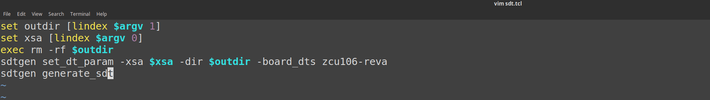
</p>

Confirme que o arquivo foi criado com sucesso:

```bash
cd /home/xmen/workspace/
cat sdt.tcl
```

<p align="center">
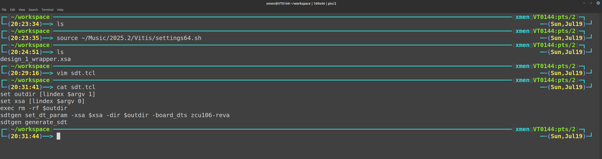
</p>

Execute o script com `xsct`, a partir do diretório de workspace:

```bash
cd /home/xmen/workspace/
```

Sintaxe geral:

```bash
xsct sdt.tcl <caminho_do_arquivo_XSA> sdt_outdir
```

Exemplo usado neste tutorial:

```bash
xsct sdt.tcl design_1_wrapper.xsa sdt_outdir
```

<p align="center">
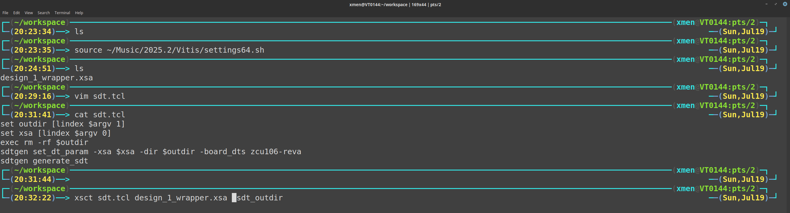
</p>

<p align="center">
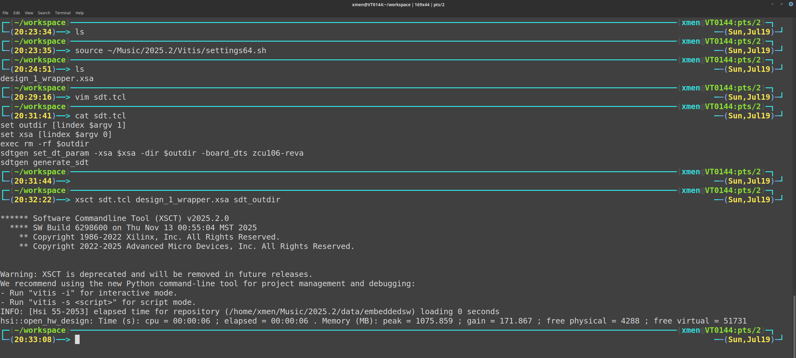
</p>

Ao final, o diretório `sdt_outdir` deve conter os arquivos de device tree gerados a partir do hardware exportado.

## 4. Criar e configurar o projeto PetaLinux

Vá até o diretório de instalação do PetaLinux e carregue o ambiente:

```bash
cd /petalinux
source settings.sh
```

<p align="center">
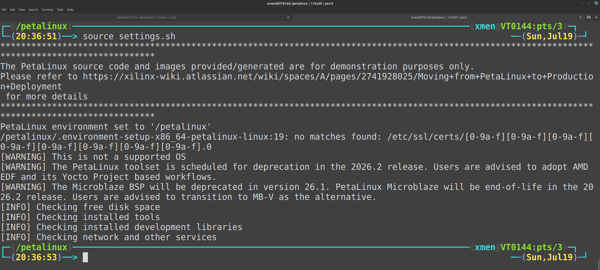
</p>

Após o carregamento, volte ao diretório do projeto:

```bash
cd -
```

Crie o projeto PetaLinux a partir do BSP da placa:

```bash
petalinux-create -t project -s <caminho_do_arquivo>.bsp
```

Exemplo usado neste tutorial:

```bash
petalinux-create -t project -s /petalinux/xilinx-zcu106-v2025.2-11160223.bsp
```

Após a execução, o diretório base do projeto deve conter a estrutura padrão de um projeto PetaLinux:

<p align="center">
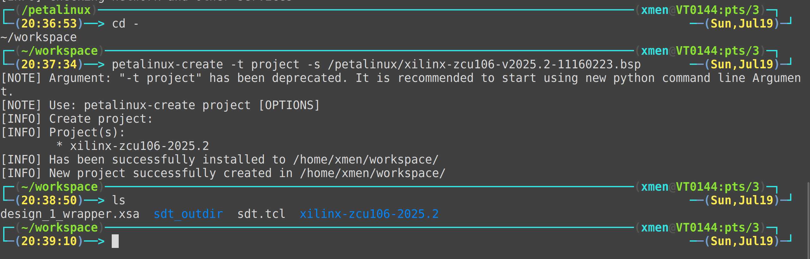
</p>

## 5. Incorporar as características do hardware ao PetaLinux

Entre no diretório do projeto criado (o nome varia conforme a versão do PetaLinux):

```bash
cd xilinx-zcu106-20xx.x
```

Neste tutorial:

```bash
cd xilinx-zcu106-2025.2
```

Aponte o projeto para o hardware exportado (diretório do SDT gerado na etapa 3):

```bash
petalinux-config --get-hw-description ../sdt_outdir
```

<p align="center">
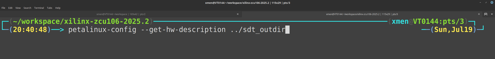
</p>

### 5.1 Threads paralelas de build

No menu de configuração, acesse:

**PetaLinux System Configuration → Yocto Settings → Parallel Thread Execution**

<p align="center">
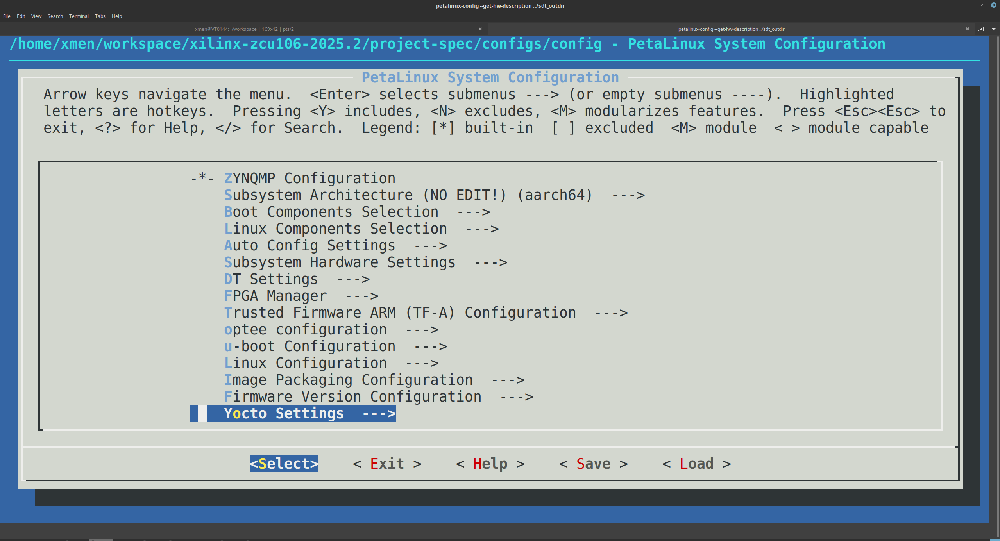
</p>

Verifique a quantidade de CPUs disponíveis no seu ambiente de trabalho:

```bash
neofetch
```

<p align="center">
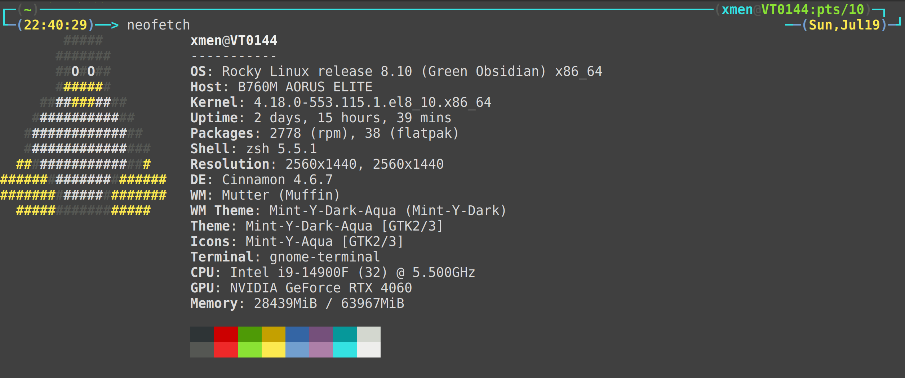
</p>

Neste exemplo, um Intel i9-14900F com 32 núcleos:

<p align="center">
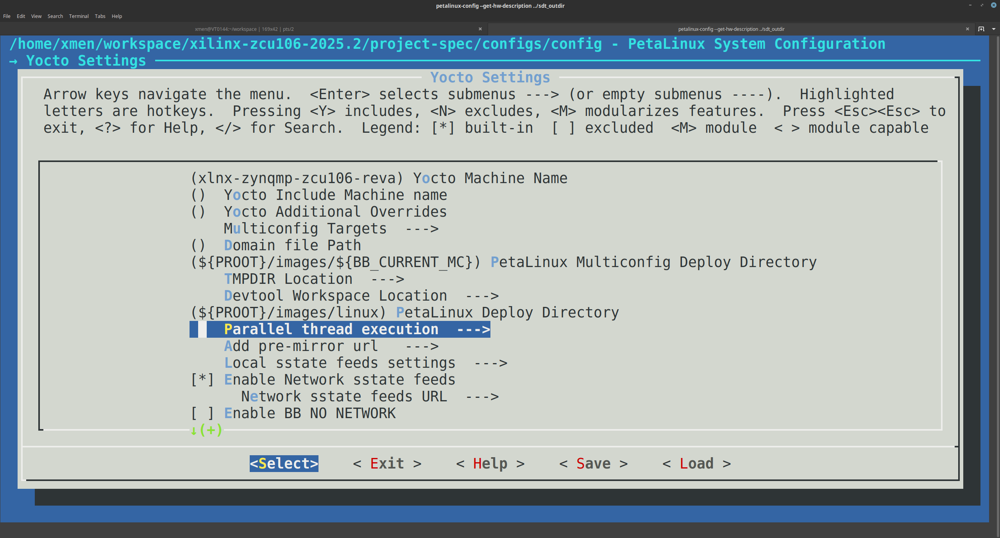
</p>

Defina os campos de paralelismo (**BB Number of Threads**, **PARALLEL_MAKE**, etc.) de acordo com a quantidade de núcleos disponível, para acelerar o build:

<p align="center">
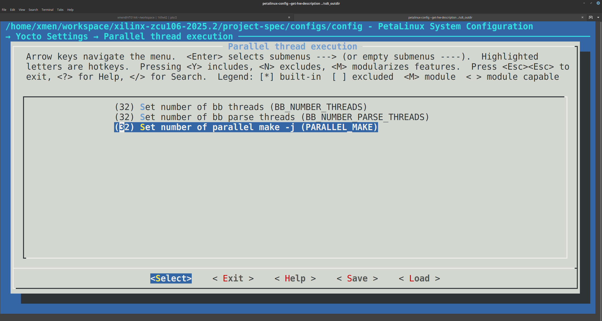
</p>

### 5.2 Argumentos de boot do kernel (UIO genérico)

Acesse:

**PetaLinux System Configuration → DT Settings → Kernel Bootargs → Add extra boot args**

Adicione um driver de kernel **Generic UIO (Userspace I/O)** à imagem, para permitir acesso aos periféricos da PL a partir do userspace:

<p align="center">
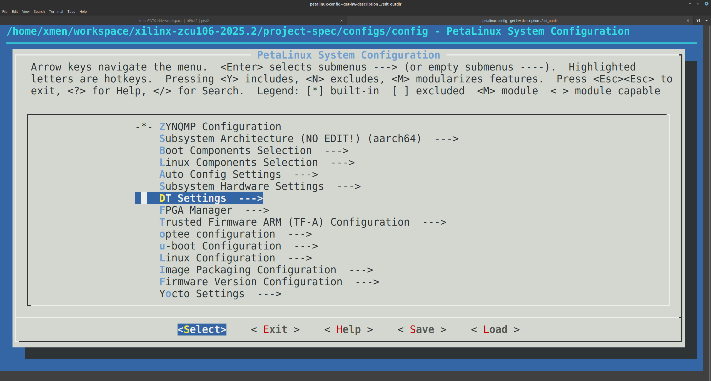
</p>

<p align="center">
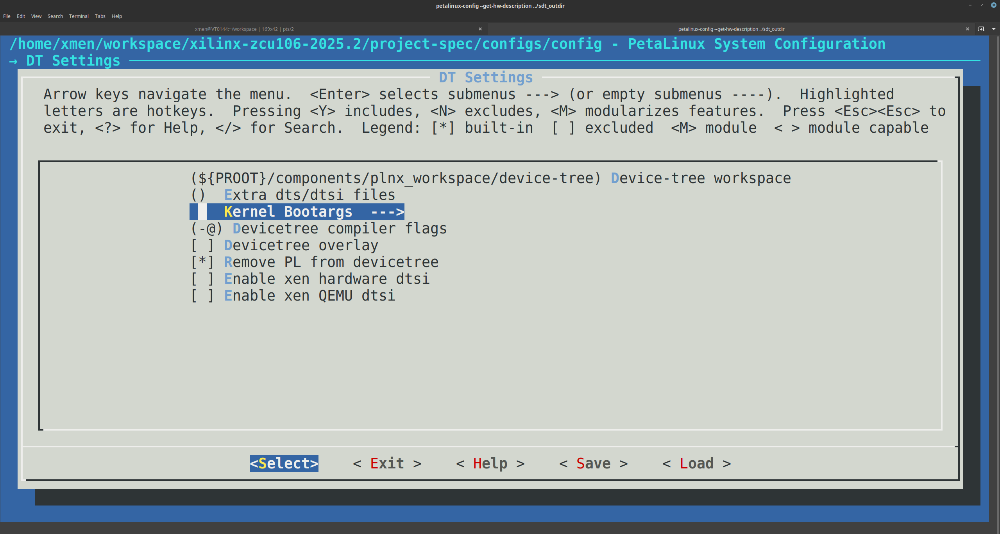
</p>

<p align="center">
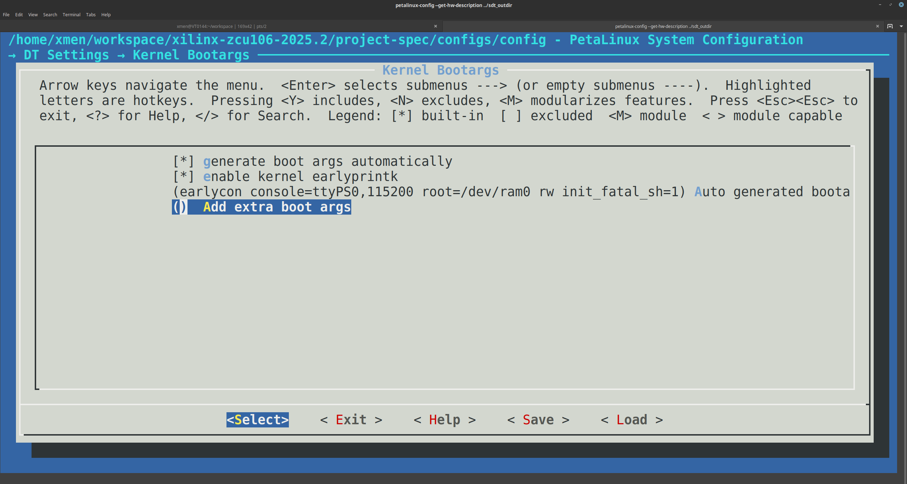
</p>

Adicione o argumento:

```
uio_pdrv_genirq.of_id=generic-uio
```

<p align="center">

</p>

### 5.3 Manter a PL no device tree

Acesse **PetaLinux System Configuration → DT Settings** e **desmarque** a opção **Remove PL from devicetree**, para que os IPs da lógica programável apareçam no device tree final:

<p align="center">

</p>

<p align="center">

</p>

### 5.4 Empacotamento de imagem

Acesse **PetaLinux System Configuration → Image Packaging Configuration** e **desmarque** a opção **Copy final images to tftpboot** (a menos que você use boot via TFTP):

<p align="center">

</p>

Salve as configurações e saia do menu **PetaLinux System Configuration**:

<p align="center">

</p>

<p align="center">

</p>

### 5.5 Sincronizar o device tree da PL

A partir do diretório do projeto (`/home/xmen/workspace/xilinx-zcu106-2025.2/`), abra os dois arquivos abaixo e copie o conteúdo de `pl.dtsi` para dentro de `system-user.dtsi`:

```bash
code ../sdt_outdir/pl.dtsi
code project-spec/meta-user/recipes-bsp/device-tree/files/system-user.dtsi
```

> **Nota:** Detalhes em Vitis-Tutorial [02 Edge IA ZCU104](https://xilinx.github.io/Vitis-Tutorials/2021-1/build/html/docs/Vitis_Platform_Creation/Introduction/02-Edge-AI-ZCU104/step2.html).
> **Nota:** Detalhes em GPIO PetaLinux [GPIO PetaLinux Part 2](https://www.linkedin.com/pulse/gpio-petalinux-part-2-roy-messinger/).

<p align="center">

</p>

Na linha correspondente ao nó `uio`, altere a propriedade `compatible` para:

```
compatible = "generic-uio";
```

Salve e feche o VS Code:

<p align="center">

</p>

<p align="center">

</p>

<p align="center">

</p>

## 6. Configurar o RootFS

```bash
petalinux-config -c rootfs
```

> **Dica:** use `/` para pesquisar as opções a serem habilitadas e selecione o item com a barra de espaço (tecla numérica) do teclado.

### Habilite os seguintes itens no rootfs

| Item | Categoria | Prioridade |
|---|---|---|
| `libstdc++` | libs | Obrigatório |
| `kmod` | misc | Obrigatório |
| `udev` | base | Obrigatório |
| `libgpiod` | libs | Necessário (GPIO) |
| `gpio-demo` | console → utils | Recomendado |
| `ssh-server-dropbear` **ou** `ssh-server-openssh` (não os dois) | console → network | Recomendado |
| `python3-numpy` | devel | Opcional (análise de dados) |
| `packagegroup-core-buildessential` | petalinux | Opcional (dev na placa, aumenta o tamanho da imagem) |
| `util-linux` | base | Necessário (boot via pen drive) |
| `e2fsprogs` | console → utils | Necessário (boot via pen drive) |
| `dosfstools` | console → utils | Necessário (boot via pen drive) |
| `gdb` | console → utils | Necessário (debug — marcar explicitamente) |
| `packagegroup-core-tools-debug` | petalinux | Opcional (símbolos de debug) |
| `strace` | console → utils | Opcional (debug) |
| `sudo` | base | Obrigatório |

**Observação:** em `gpio-demo`, mantenha as seguintes opções habilitadas:

<p align="center">

</p>

<p align="center">

</p>

Salve as configurações e saia do menu **Configuration**:

<p align="center">

</p>

## 7. Compilar o PetaLinux

O build pode levar de alguns minutos a algumas horas, dependendo do hardware do seu computador e da quantidade de threads configurada.

```bash
petalinux-build
```

<p align="center">

</p>

É comum que a **primeira execução** apresente avisos e erros relacionados a cache do Yocto/BitBake, fazendo o build falhar. Nesse caso, basta executar o comando novamente — o cache já parcialmente construído normalmente resolve o problema na segunda tentativa. Para mais detalhes sobre falhas conhecidas de build, consulte o guia de troubleshooting do PetaLinux/Yocto, por exemplo a seção ["Build failures" da documentação do RPi Camera FMC](https://rpi.camerafmc.com/en/latest/troubleshooting.html) ou a documentação oficial da AMD/Xilinx para a sua versão de ferramentas.

<p align="center">

</p>

Execute novamente:

```bash
petalinux-build
```

<p align="center">

</p>

### Compilação bem-sucedida

Ao final, os artefatos de boot (`BOOT.BIN`, `boot.scr`, `image.ub`/`Image`, `system.dtb`, rootfs) estarão disponíveis em `images/linux/` dentro do projeto, prontos para serem gravados em um cartão SD/pen drive ou usados via TFTP/JTAG.

<p align="center">

</p>

## 8. Boot via JTAG / Pen Drive

A escolha desse método se deu em virtude da restrição imposta de realizar todo o processo remotamente, sem a necessidade de contato físico com a FPGA — ou seja, sem manipular os switches que outros métodos exigiriam. Existe também um método que usa `petalinux-boot jtag --kernel`, mas o sistema resultante fica incompleto e não foi aprofundado neste tutorial.

### Passo 1 — Copiar os artefatos para o pen drive

Copie os artefatos gerados pelo build (neste exemplo, de `/home/xmen/workspace/images/linux`) para o pen drive (neste exemplo, `/run/media/xmen/valmir`):

<p align="center">

</p>

Crie uma pasta no seu pen drive com o nome que desejar.

Use o comando abaixo para listar os discos disponíveis:

```bash
df -h
```

No exemplo deste tutorial, o pen drive está montado em `/run/media/xmen/valmir`:

```bash
cd /run/media/xmen/valmir
mkdir workspace
```

Copie os artefatos `rootfs.cpio.gz.u-boot` e `image.ub` para o pen drive:

```bash
cd ~/workspace/xilinx-zcu106-2025.2/images/linux
cp rootfs.cpio.gz.u-boot image.ub /run/media/xmen/valmir/workspace
```

<p align="center">

</p>

### Passo 2 — Conectar o pen drive e abrir o monitor serial

Após copiar os arquivos, conecte o pen drive na FPGA.

Inicie o Vitis e vá em **Vitis → Serial Monitor**. Selecione a primeira UART referente ao ZYNQ:

<p align="center">

</p>

<p align="center">

</p>

Carregue o ambiente PetaLinux novamente:

<p align="center">

</p>

E vá até o diretório do projeto (`/home/xmen/workspace/xilinx-zcu106-2025.2`):

<p align="center">

</p>

### Passo 3 — Iniciar o U-Boot via JTAG

Inicie o U-Boot com uma imagem pré-compilada:

```bash
petalinux-boot jtag --prebuilt 2
```

<p align="center">

</p>

### Passo 4 — Carregar os arquivos para a memória RAM

No terminal da UART:

```
zynq>
zynq> fatload usb 0:1 0x10000000 {diretório da pasta do pen drive}/image.ub
```

> **Obs.:** o dispositivo `usb 0:x` pode variar, e o diretório depende da pasta que você criou no pen drive.

Neste exemplo:

```
fatload usb 0:1 0x10000000 workspace/image.ub
fatload usb 0:1 0x20000000 workspace/rootfs.cpio.gz.u-boot
```

<p align="center">

</p>

### Passo 5 — Boot pela memória RAM

```
bootm 0x10000000 0x20000000
```

<p align="center">

</p>

> **Obs.:** por esse método, é esperado que o boot fique travado nesta tela — isso acontece porque ainda falta gravar o bitstream na lógica programável.

<p align="center">

</p>

### Passo 6 — Gravar o bitstream na lógica programável

No Vivado, vá em **PROGRAM AND DEBUG → Program Device**, selecione a placa (neste exemplo, `xczu7_0`):

<p align="center">

</p>

**PROGRAM AND DEBUG → Program Device → `xczu7_0` → Program**

<p align="center">

</p>

Após isso, o sistema inicializará:

<p align="center">

</p>

### Passo 7 — Login inicial e acesso via SSH

Por padrão, o usuário é `petalinux`; a senha é a que você definiu durante o primeiro acesso.

<p align="center">

</p>

A essa altura, você já deve ter percebido que, ao usar a UART, os comandos aparecem duplicados. Por isso, recomenda-se a utilização do SSH. Para isso, é preciso conectar a FPGA à rede e descobrir o endereço IP associado:

```bash
ifconfig
```

Neste exemplo, o IP obtido foi `192.168.130.31`:

<p align="center">

</p>

Abra um terminal no host e conecte via SSH:

```bash
ssh petalinux@192.168.130.31
```

<p align="center">

</p>

> **Obs.:** use a senha definida anteriormente.

<p align="center">

</p>

### Passo 8 — Verificar o reconhecimento do UIO

Checagem do reconhecimento do Generic Userspace I/O (UIO):

```bash
cat /sys/class/uio/uio*/name
```

<p align="center">

</p>

## 9. Deploy na FPGA

Com o sistema no ar e acessível via SSH, o deploy da aplicação segue os passos abaixo:

1. Use `scp` para copiar o `.tar` gerado no container para a FPGA, em `/home/petalinux`.
2. Extraia o conteúdo do `.tar` e entre como usuário `sudo`:
   ```bash
   sudo -i
   ```
3. Carregue a biblioteca a partir de `deploy_all_files`:
   ```bash
   export LD_LIBRARY_PATH=./lib
   ```
4. Execute o binário:
   ```bash
   ./bin/ExplorationMultipleReactorsCodesign
   ```

O projeto usado como exemplo está na pasta `examples` e explora a utilização de múltiplos reatores a partir de uma extensão do subconjunto da linguagem Lingua Franca voltada para o *Codesign of Reactor-Oriented Hardware and Software for Cyber-Physical Systems*.

<p align="center">

</p>

<p align="center">

</p>

Caso ocorra um erro de **Bus error (core dumped)**, será necessário programar novamente o bitstream — use os passos descritos na [seção 8](#8-boot-via-jtag--pen-drive).

<p align="center">

</p>

Execute novamente:

<p align="center">

</p>

---

> Este tutorial ainda tem margem para melhoria e otimização — contribuições e sugestões são bem-vindas.

## 10. Links Úteis

- [Tutorial ZCU104](https://www.hackster.io/engrinam0077/zcu104-mpsoc-development-petalinux-2024-2-basic-tutorial-c82b8d)
- ["Build failures" da documentação do RPi Camera FMC](https://rpi.camerafmc.com/en/latest/troubleshooting.html)
- [TCL File Mode - Xilinx System-Device-Tree-xlnx](https://github.com/Xilinx/system-device-tree-xlnx/blob/master/README.md).
- [Fluxo AVNET](https://gitlab.avnet.com/xilinx/example-board-projects/zcu106/vitis-platforms/avnet-sme-zcu106-vitis-platform-workflow-training/-/tree/main/2021.2/avtsme_zcu106_base)
- [Tutorial ZCU106](https://www.fpgalover.com/index.php/boards/39-zcu106/97-build-petalinux-for-zcu106-ps-and-pl-based-10g-ethernet)
- [Documentação PetaLinux](https://docs.amd.com/r/en-US/ug1144-petalinux-tools-reference-guide/Introduction)
- [02 Edge IA ZCU104](https://xilinx.github.io/Vitis-Tutorials/2021-1/build/html/docs/Vitis_Platform_Creation/Introduction/02-Edge-AI-ZCU104/step2.html).
- [GPIO PetaLinux Part 2](https://www.linkedin.com/pulse/gpio-petalinux-part-2-roy-messinger/).
